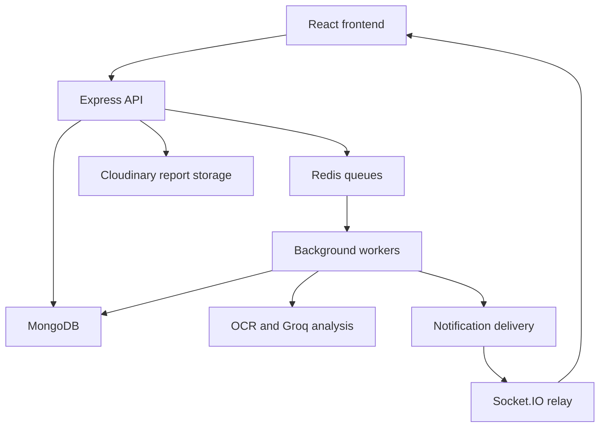

# BioPulse

BioPulse is a full-stack health management application for patients and doctors. It combines medicine tracking, appointment scheduling, prescriptions, medical report processing, diet planning, notifications, and AI chat.

The frontend is **React 19 + Vite + JavaScript/JSX**. The API is **Express 5 + Mongoose**, with **MongoDB**, **Redis/BullMQ**, and **Socket.IO**. Report files use Cloudinary; OCR uses Tesseract and `pdf-parse`; AI responses use Groq.

## Features and access

| Area | Implemented behavior |
| --- | --- |
| Accounts | Patient/doctor signup, login, rotating refresh cookies, password changes, profile updates, admin account bans |
| Medicines | Create/edit/deactivate medicines, dosage/unit/food instructions, daily/weekly/custom weekdays, timezone-aware reminders, today's doses, dose logs and adherence statistics |
| Appointments | Doctor schedules, capacity-limited booking, automatic selection of the next available slot, rescheduling, cancellation, queue numbers and doctor status updates |
| Prescriptions | Doctor-created prescriptions tied to the correct patient appointment, patient prescription history, printable views and reusable doctor templates |
| Reports | JPEG/PNG/PDF upload, text extraction, scanned PDF OCR, structured biomarker extraction, analysis status polling, AI insights, retries, trends and deletion |
| Diet | Rule-based calorie/macro plan generation, manual meal entries, food search, condition categories and diet chat |
| Notifications | Stored notifications, unread/read state, authenticated Socket.IO rooms, optional Firebase browser push and SMTP email |
| AI assistant | Authenticated health and diet chat with bounded user/assistant conversation history |

Admin privileges cannot be requested through signup. Administrators must be provisioned through a trusted database/administrative process. Patient records are accessible to that patient, an administrator, or a doctor with a non-cancelled appointment for that patient. Doctor queues hide other patients' names from patient viewers.

Doctor signup is currently self-service; the application does not verify professional credentials. Diet plans are generated by rules and placeholder meal allocations, not by a trained nutrition model. Report scores and AI output are informational software features, not validated diagnostic or treatment systems.

## Architecture



Requests flow through routes, validation/authentication middleware, controllers, services, and repositories. MongoDB transactions keep appointment records and slot counts consistent. Redis queues handle work outside the HTTP request.

```text
backend/
  src/config/          Environment, database, Redis and Socket.IO
  src/routes/          API endpoints
  src/schemas/         Zod request validation
  src/controllers/     HTTP handling; aiSystem.js contains report analysis helpers
  src/services/        Application logic
  src/repositories/    Database queries
  src/models/          Mongoose schemas and indexes
  src/utils/           Uploads, PDF/OCR helpers, JWTs, scheduling and email
  src/workers/         BullMQ processors
  src/server.js        API, relay, cron and optional embedded workers
  src/worker.js        Standalone worker entrypoint
  test/                Integration and regression tests
frontend/
  src/api/             Axios client and endpoint wrappers
  src/pages/           Application screens
  src/components/      Shared UI, chat and notification bell
  src/hooks/           Socket.IO and Firebase registration
  src/stores/          Zustand authentication, medicine and notification state
```

## Requirements

- **Node.js 24** and npm. Use the committed lockfiles with `npm ci`.
- **MongoDB replica set**, including MongoDB Atlas, for appointment and prescription transactions. A standalone MongoDB instance cannot run these workflows.
- **Redis 6.2+** for BullMQ.
- Cloudinary credentials for report uploads; Groq credentials for report analysis and AI chat.
- Optional USDA FoodData Central key, SMTP credentials and Firebase credentials.

For a local MongoDB replica set, create a data directory and start MongoDB with `mongod --replSet rs0 --bind_ip 127.0.0.1 --dbpath <your-data-directory>`. Initialize it once using `mongosh --eval 'rs.initiate()'`. Start Redis separately. Keep these services private to your machine/network.

## Local setup

```bash
git clone https://github.com/prince1211-alt/BioPulse.git
cd BioPulse
cp backend/.env.example backend/.env
cp frontend/.env.example frontend/.env
npm --prefix backend ci
npm --prefix frontend ci
```

Edit both `.env` files. Generate two independent JWT secrets, for example by running `node -e "console.log(require('node:crypto').randomBytes(48).toString('hex'))"` twice.

Start the API and frontend in separate terminals:

```bash
npm --prefix backend run dev
npm --prefix frontend run dev
```

Defaults:

- Frontend: `http://localhost:5173`
- API base: `http://localhost:4000/api/v1`
- Health endpoint: `http://localhost:4000/api/health`
- Socket.IO: `http://localhost:4000`

The API starts workers by default. To run them separately, set `RUN_WORKERS=false` in `backend/.env`, then run `npm --prefix backend run worker` in another terminal. The API process still owns notification relay and meal cron scheduling. Do not run multiple cron-owning API replicas without adding leader election/deduplication.

## Configuration

| Backend variable | Purpose |
| --- | --- |
| `NODE_ENV`, `PORT` | Runtime mode and API listening port |
| `DATABASE_URL` | MongoDB connection URI; use a replica set |
| `REDIS_URL` | Redis connection URI; `rediss://` where required |
| `JWT_SECRET`, `JWT_REFRESH_SECRET` | Independent signing secrets; production rejects missing/equal secrets or secrets shorter than 32 characters |
| `FRONTEND_URL` | Comma-separated exact frontend origins, including protocol; no trailing slash |
| `TRUST_PROXY` | Number of trusted reverse proxy hops; default `0` |
| `RUN_WORKERS` | Set `false` when a separate worker process consumes the queues |
| `CLOUDINARY_CLOUD_NAME`, `CLOUDINARY_API_KEY`, `CLOUDINARY_API_SECRET` | Authenticated report asset storage and signed delivery |
| `GROQ_API_KEY` | Report analysis, health chat and diet chat |
| `USDA_API_KEY` | Optional food search; without it, searches return an empty result |
| `SMTP_HOST`, `SMTP_PORT`, `SMTP_USER`, `SMTP_PASS` | Optional email notifications; port 465 uses TLS |
| `GOOGLE_APPLICATION_CREDENTIALS` | Optional absolute path to a Firebase Admin service-account file |
| `FIREBASE_PROJECT_ID`, `FIREBASE_CLIENT_EMAIL`, `FIREBASE_PRIVATE_KEY` | Alternative Firebase Admin credentials; escaped newlines in private keys are supported |

`VITE_API_URL` must include `/api/v1`. `VITE_SOCKET_URL` points to the API origin. Optional `VITE_FIREBASE_*` settings and `VITE_FIREBASE_VAPID_KEY` enable browser push. These frontend values are public web configuration; never place service-account private keys or server API secrets in `VITE_*` variables.

Firebase push requires HTTPS or localhost, a supported browser, notification permission, and a successfully activated service worker. The worker loads Firebase compat scripts from Google's CDN; deployment policies must allow those scripts. Browsers may block third-party refresh cookies: use frontend/API domains under the same site or a reverse proxy when needed. Production refresh cookies use `Secure`, `HttpOnly` and `SameSite=None`.

## API overview

All endpoints below use `/api/v1`. Except register/login/refresh, routes require `Authorization: Bearer <accessToken>`. The frontend sends `x-timezone` with its IANA timezone. Medicine and doctor schedule creation persist that timezone; defaults use `Asia/Kolkata`.

| Prefix | Main endpoints |
| --- | --- |
| `/auth` | `POST /register`, `/login`, `/logout`, `/refresh`; `GET /me`; `PATCH /password`; `PUT /fcm-token` |
| `/users` | `GET/PATCH/DELETE /me`; `GET /doctors/:doctorId`; admin listing/detail/ban; authorized `GET /:userId/history` |
| `/medicines` | CRUD; `GET /schedule/today`, `/adherence`; `POST /log` |
| `/appointments` | Listing/booking; `POST /auto-book`; `PATCH /:id/reschedule`, `/:id/status`, `/:id/queue-status`; `DELETE /:id`; doctor listing/schedules/queue |
| `/prescriptions` | Doctor creation/listing/templates; patient listing; authorized `GET /:id` |
| `/reports` | `POST /upload`; listing/detail/status; `POST /:id/reanalyze`; deletion; `/trends/:biomarker`; authorized `/patient/:patientId` |
| `/diet` | `/current`, `/history`, `/recommendations`, `/search`; `POST /generate`, `/chat`, `/meal`; plan updates/deletion and meal removal |
| `/notifications` | Listing and `PATCH /:id/read` |
| `/chat` | `POST /health` |

Success responses use `{ success: true, data, message }`; errors use `{ success: false, error: { code, message } }`. Validation failures return 400, forbidden access 403, unavailable records 404, conflicts 409 and unavailable queue-dependent operations 503.

Report uploads are `multipart/form-data` with `file`, `report_type`, and optional `report_date`. Supported files are JPEG, PNG and PDF up to **10 MiB**; signatures are checked before cloud upload. PDF processing supports up to **20 pages**. Report categories are `blood_test`, `lipid_panel`, `diabetes`, `thyroid`, `urine`, `xray`, `mri`, and `other`; imaging categories do not imply medical image interpretation.

Reports progress through `pending → processing → done/failed` for OCR and analysis separately. Failed AI analysis stays failed and can be retried. Empty/unsupported biomarker extraction does not produce a numeric risk score. OCR supports English; accuracy depends on scan quality and recognizable report labels/units. Tesseract may need network access to download its English language data on first use.

Medicine `times` use `HH:mm`. Weekly schedules use the local weekday of `start_date`; custom schedules require `days_of_week` with Sunday `0` through Saturday `6`. Date-only starts/ends use the medicine's local start/end of day. Only matching, non-future scheduled doses can be logged. `snoozed` is a log status; it does not schedule an additional reminder. Adherence currently covers active medicines, not a complete historical record of deactivated treatment courses.

## Checks

```bash
npm --prefix backend test
npm --prefix frontend run lint
npm --prefix frontend test
npm --prefix frontend run build
npm --prefix backend audit --omit=dev
npm --prefix frontend audit --omit=dev
```

Backend integration tests start an isolated temporary MongoDB replica set using `mongodb-memory-server`. The first run downloads a MongoDB binary; allow outbound network access and sufficient disk space. Tests use isolated queue/email/push doubles and do not need your production credentials or a running Redis instance. Other tests cover actual PDF parsing, OCR normalization, timezone scheduling, session refresh races and chat HTML escaping.

GitHub Actions runs backend tests and frontend lint/tests/build on pull requests and pushes to `main`. The health endpoint reports HTTP liveness; it is not a readiness check for every external service.

## Deployment and upgrades

1. Set `NODE_ENV=production`, production database/Redis URIs, independent JWT secrets and exact frontend origins. Configure `TRUST_PROXY` for the hosting topology.
2. Run the API with `npm start` from `backend`. Keep Redis eviction policy at `noeviction` for queue correctness. Use persistent MongoDB/Redis services and backups.
3. Build the frontend with `npm run build` from `frontend` and serve `frontend/dist`. Configure SPA rewrites to `index.html`, plus the public service worker path.
4. Verify login, refresh, booking, report upload/processing and actual notification delivery against your configured services before production use.

Before upgrading an existing database:

- Existing refresh sessions must log in again because refresh-token storage now hashes the full JWT with SHA-256 instead of bcrypt.
- Resolve duplicate doctor/date schedules, active duplicate patient/doctor/time bookings, duplicate medicine dose logs and duplicate non-template prescriptions before creating the new unique indexes. Back up the database before any cleanup. Index creation can fail until these duplicates are resolved; application tests do not modify your database.
- Existing medicine reminder jobs should be removed/recreated by editing medicines after deployment. This updates old colon-containing job IDs, timezones and repeat boundaries.
- Old Cloudinary assets are not automatically made private. Migrate/re-upload old public reports and verify access controls before using them for sensitive records. Newly uploaded reports use authenticated delivery and stored asset metadata. Signed download URLs are bearer links; protect them from logging/sharing and add time-limited access controls if required by your deployment.
- If Redis is unavailable, listings and many database-only actions remain available, while report uploads and medicine mutations fail promptly with 503. Appointment writes can succeed while reminder scheduling fails; check server logs and reconcile reminders after an outage. A durable transactional outbox is not implemented.

Account deletion currently removes the account record; it is not a complete medical-data erasure/export workflow. Low-stock worker code is scaffolded but stock quantities, decrementing inventory and recurring stock checks are not connected into a complete feature. Clinical formulas, reference ranges, generated recommendations, professional credential verification and regulatory suitability require separate review before real healthcare use.

See [the audit notes](docs/AUDIT.md) for fixes, regression coverage and verification limits.
