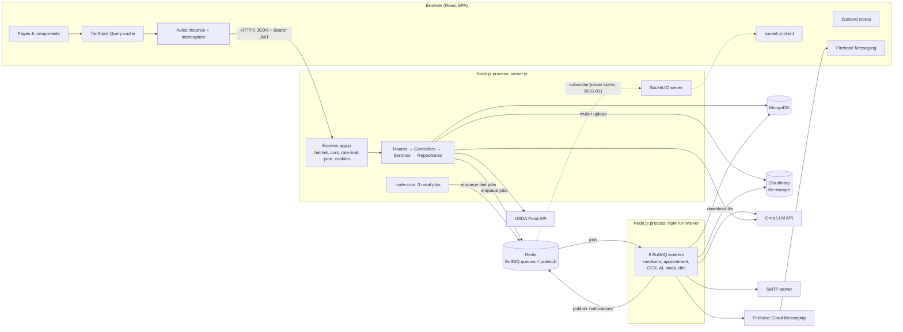

# Part I — Project Overview and Requirements

## 1.1 Main idea (one sentence)

**BioPulse is a full-stack healthcare web app where patients track medicines, book doctors, upload lab reports that are read by OCR and explained by an AI model, plan their diet, and chat with an AI assistant — while doctors manage time slots, a live token queue and digital prescriptions.**

---

## 1.2 What the repository contains

| Part | Folder | Stack |
|---|---|---|
| Backend REST API + real-time server | `backend/src/` | Node.js (ES modules), Express 5, MongoDB via Mongoose 9, Socket.IO |
| Background processing | `backend/src/workers/`, `queues/`, `cron.js` | Redis, BullMQ, node-cron, Tesseract.js, sharp, pdf-parse |
| AI / external services | `controllers/aiSystem.js`, `services/*.service.js`, `utils/` | Groq LLM API (Llama 3.3 70B), USDA FoodData Central, Cloudinary, Firebase Cloud Messaging, SMTP (Nodemailer) |
| Frontend SPA | `frontend/src/` | React 19, Vite 8, Tailwind CSS 4, React Router 7, TanStack Query 5, Zustand 5, react-hook-form + Zod |

✅ Fact: there is **no** Dockerfile, CI workflow, `.env.example`, root README, or monorepo tooling. `frontend/README.md` is the unmodified Vite template.

---

## 1.3 Users and roles

| Role | How it is set | What the UI shows (✅ `frontend/src/App.jsx:33-40`) |
|---|---|---|
| `patient` | Default at signup | Dashboard, Medicines, Prescriptions, Appointments, Reports, Diet, Profile |
| `doctor` | Chosen at signup (`role: 'doctor'` + specialisation) | Dashboard (live queue), Appointments (slot manager, prescribe, patient history), Profile |
| `admin` | Only possible by editing the database (✅ `auth.service.js:27` downgrades anything except patient/doctor) | Dashboard + Appointments; **no admin UI exists** |

---

## 1.4 Requirements (inferred from the code)

There is no requirements document. These are **inferred** from implemented code — present them as "the goals I built for", not as a formal spec.

### Functional requirements

1. **Accounts** — register, login, logout, refresh session, change password, view/update profile.
2. **Medicines** — add/edit/delete medicines with daily times; see today's dose schedule; mark doses taken/missed/skipped; see 30-day adherence; receive reminders (push, email, in-app).
3. **Appointments** — doctors publish dated schedules split into slots with capacity; patients browse doctors, book, reschedule, cancel; token numbers per day; doctors run a live queue (call in / done / no-show); reminders 24 h and 1 h before.
4. **Prescriptions** — doctor writes a prescription for an appointment (marks it completed); templates; patient lists/views/prints prescriptions.
5. **Health reports** — upload image/PDF → OCR → biomarker extraction → rule-based risk score → LLM clinical summary → notification; trends; re-analyse; delete.
6. **Diet** — rule-based recommendations by patient type; manual food logging with macro validation; USDA food search; AI dietitian chat; (backend-only) 7-day plan generation.
7. **AI health assistant** — floating chatbot using the patient's profile as context.
8. **Notifications** — stored in MongoDB (30-day TTL), shown with a bell and a dashboard panel, plus push (FCM) and email.

### Non-functional requirements visible in code

| Concern | Evidence |
|---|---|
| Security headers | `helmet()` (`app.js:24`) |
| CORS allow-list | `app.js:26-44` |
| Rate limiting | 20 req/15 min on `/auth`, 200 req/15 min elsewhere (`app.js:46-61`) |
| Short-lived access tokens | 15 min JWT + 7 day refresh cookie (`utils/jwt.js:5-6`) |
| Async heavy work | OCR and AI in BullMQ workers, not in the request (`report.service.js:47-52`) |
| Resilience to Redis outage | API starts without workers if Redis is down (`server.js:56-58`) |
| Graceful shutdown | `server.js:82-118` |
| Structured logs (partly) | JSON log helpers in `workers/index.js:37-41`, `report.service.js:10-14` |
| Response compression | `compression()` (`app.js:63`) |
| Code splitting | `React.lazy` per page (`App.jsx:14-23`) |

---

## 1.5 Feature status — honest view

Legend: 🟢 works as designed (by code reading) · 🟡 works with important defects · 🔴 broken or not wired · ⚪ backend only, no UI

| Feature | Status | Why (details in referenced chapter) |
|---|---|---|
| Register / login / logout / `me` | 🟢 | Validation messages are always generic (BUG-03). |
| Refresh token rotation | 🟡 | Old refresh tokens still accepted — bcrypt 72-byte limit (SEC-05, 🔬). |
| Change password | 🟢 | Existing access tokens stay valid up to 15 min (by design of JWT). |
| Profile update | 🟡 | `chronic_conditions`, `emergency_contact` are dropped by Mongoose strict mode (BUG-04, 🔬). |
| Medicines CRUD + today schedule + dose log | 🟢/🟡 | Editing a medicine returns 500 instead of 404/400 on errors (BUG-06). Optimistic UI has no visible effect (BUG-16). |
| Medicine reminders | 🔴 with `npm start` alone | Workers never start inside `server.js` (BUG-01, 🔬). Work only with the separate `npm run worker` process. Old reminders are never removed (BUG-05, 🔬). |
| Adherence stats | 🟡 | Counts today's future doses as expected (BUG-17). |
| Doctor schedules + slots | 🟡 | Times interpreted in the **server's** time zone (BUG-18). |
| Booking + tokens + queue | 🟡 | Race conditions → overbooking, duplicate tokens (BUG-07). |
| Reschedule | 🔴 in UI | Modal requests `/doctors/[object Object]/schedules` → no slots (BUG-08). |
| Cancel | 🟢 | Can also cancel completed appointments (BUG-29). |
| Prescriptions | 🟡 | "Save as template" hides the real prescription from the patient (BUG-14). Print hides the content (BUG-21). |
| Image report OCR + AI | 🟡 | Needs the worker process. Hemoglobin and µmol/L extraction bugs; risk score saturates (BUG-12, BUG-13). |
| PDF report OCR | 🔴 | Crashes the worker process (BUG-02, 🔬). |
| Report status polling UI | 🔴 | Reads the wrong response level; React Query v5 callback misuse (BUG-09). |
| Diet logging + recommendations + search + chat | 🟡 | "Today" never resets (BUG-15). Weekly chart has no data source. |
| Diet plan generation | ⚪ | `POST /diet/generate` exists; no frontend call. |
| Diet meal reminders (cron) | 🔴 | Worker queries `is_banned:false`, a field that is never stored → 0 users (BUG-04, 🔬). |
| Low-stock alerts | 🔴 | Nothing enqueues `low-stock-check`; Medicine has no `quantity` field. Dead code. |
| AI health chatbot | 🟡 | Renders LLM output with `dangerouslySetInnerHTML` (SEC-06). |
| In-app notifications (bell, panel) | 🟢 | 30-second polling. |
| Real-time socket notifications | 🔴 | Relay never starts (BUG-01); unauthenticated rooms (SEC-03); client reads wrong fields (BUG-11). |
| Push notifications (FCM) | ❓ | Token registration code exists; `public/firebase-messaging-sw.js` is **empty (0 bytes)**, so background display is unverified. |
| Email notifications | ❓ | Depends on SMTP credentials. |
| Admin: list users, view any user, ban | ⚪ + 🔴 security | No UI; endpoints have **no role check** (SEC-01, 🔬); ban is a no-op (BUG-04). |

**Interview takeaway:** describe BioPulse as a *feature-rich prototype with a production-style architecture* (layers, queues, workers, real-time), and be ready to name its known defects and how you would fix them. Interviewers respect honesty plus a concrete fix far more than a claim that "everything works".

---

## 1.6 Architecture at a glance

---

## 1.7 Codebase size

| Area | Files | Lines (approx.) |
|---|---|---|
| Backend `src/` | 69 source files + 1 test file | ~5,200 |
| Frontend `src/` | 44 files (incl. 3 image assets, 2 CSS files) | ~7,200 |
| Other (configs, lock files, `public/`, `eng.traineddata`) | 17 | — |
| **Total tracked** | **131 files** (74 backend, 57 frontend) | ~12,900 (excluding lock files and binaries) |

Git history: 50 commits, two author names (`prince kumar`, `prince1211-alt`), commit messages such as "user controller fixd", "whole frontend". The last commit (`d7b220e`, 2026-05-25, "whole frontend") changed 15 frontend files (+3,806 / −226 lines) in one go.
