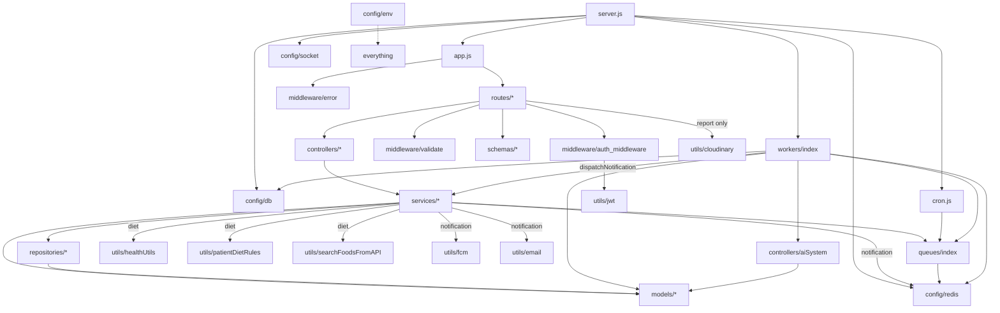

# Part II — Complete Repository Structure

## 2.1 Folder tree (all 131 tracked files)

```
BioPulse/
├── backend/                          ← Node.js API + workers (74 files)
│   ├── .gitignore
│   ├── eng.traineddata               ← 5.2 MB Tesseract English model (binary)
│   ├── package.json / package-lock.json
│   └── src/
│       ├── server.js                 ← process entry: HTTP + Socket.IO + Redis relay + cron + shutdown
│       ├── app.js                    ← Express app: middleware chain + route mounting
│       ├── cron.js                   ← node-cron: breakfast/lunch/dinner jobs
│       ├── config/   db.js env.js redis.js socket.js
│       ├── middleware/ auth_middleware.js error.js validate.js
│       ├── routes/   auth user medicine appointment report diet notification prescription chat (.routes.js)
│       ├── controllers/ auth user medicine appointment report diet notification prescription chat (.controller.js)
│       │               aiSystem.js   ← AI/clinical scoring module (not an HTTP controller)
│       ├── services/ auth user medicine appointment report diet notification prescription chat (.service.js)
│       ├── repositories/ appointment diet medicine report user (.repository.js)
│       ├── models/   User Medicine(+MedicineLog) Appointment Schedule HealthReport DietPlan Notification Prescription
│       ├── schemas/  auth user medicine appointment report diet (.schema.js)  ← Zod request schemas
│       ├── queues/index.js           ← 6 BullMQ Queue objects
│       ├── workers/index.js          ← 6 BullMQ Worker processors + OCR/biomarker helpers
│       └── utils/    AppError asyncHandler response jwt email fcm cloudinary
│                     healthUtils patientDietRules searchFoodsFromAPI
│                     __tests__/healthUtils.test.js
└── frontend/                         ← React SPA (57 files)
    ├── index.html  vite.config.js  eslint.config.js  babel.config.json  jsconfig.json
    ├── package.json / package-lock.json  .gitignore  README.md  rename-jsx.cjs
    ├── public/ favicon.svg  icons.svg  firebase-messaging-sw.js (EMPTY)
    └── src/
        ├── main.jsx  App.jsx  index.css  App.css (unused)
        ├── api/      axios.js auth.api.js user.api.js medicine.api.js appointment.api.js
        │             report.api.js diet.api.js prescription.api.js chat.api.js
        ├── stores/   authStore.js medicineStore.js notificationStore.js     ← Zustand
        ├── hooks/    useFCM.js useSocket.js
        ├── lib/      firebase.js utils.js
        ├── components/ Navigation Footer NotificationBell SmartChatbot
        │               MedicineSchedule (unused) AddMedicineForm (unused)
        │               ui/ Button Card Input Label Skeleton
        ├── pages/    Home Login Signup Dashboard Medicines Appointments
        │             Prescriptions Reports Diet Profile
        └── assets/   hero.png react.svg vite.svg (all unused)
```

---

## 2.2 Languages and file types

| Type | Where | Notes |
|---|---|---|
| JavaScript (ES modules) | backend `"type": "module"`, frontend `"type": "module"` | `import/export` everywhere; one CommonJS script (`rename-jsx.cjs`). |
| JSX | `frontend/src/**/*.jsx` | Compiled by `@vitejs/plugin-react`. |
| CSS | `index.css` (Tailwind v4 `@theme`, CSS variables), `App.css` (unused template CSS) | |
| JSON | package files, `jsconfig.json`, `babel.config.json` | |
| HTML | `frontend/index.html` | SPA shell; loads Inter font from Google Fonts. |
| SVG / PNG | `public/`, `src/assets/` | Vite template leftovers. |
| Binary model | `backend/eng.traineddata` | Tesseract LSTM English model. |

There is **no TypeScript** even though `eslint.config.js`, `babel.config.json` and the README refer to it (leftovers from a TS template; `rename-jsx.cjs` was a one-off migration script that renamed `.js` files containing JSX to `.jsx`).

---

## 2.3 Backend file inventory (purpose of every file)

### Entry, app, config

| File | Lines | Purpose | Imported by |
|---|---|---|---|
| `src/server.js` | 130 | Creates HTTP server, attaches Socket.IO, connects MongoDB and Redis, starts Redis→Socket relay and workers (if Redis "ready"), starts cron, listens, handles signals. | `npm start` / `npm run dev` |
| `src/app.js` | 101 | Express app: helmet, CORS, rate limiters, compression, morgan, body parsers, cookies, `/api/health`, 9 routers, 404, error handler. | `server.js` |
| `src/cron.js` | 29 | Three daily node-cron jobs (08:00, 13:00, 19:00 Asia/Kolkata) that enqueue diet reminder jobs. | `server.js` |
| `src/config/env.js` | 44 | Loads `backend/.env`, warns on missing vars, exports `env` with defaults (incl. insecure JWT defaults). | almost every module |
| `src/config/db.js` | 14 | `mongoose.connect(env.DATABASE_URL)`; exits process on failure. | `server.js`, `workers/index.js` |
| `src/config/redis.js` | 40 | Shared ioredis client (auto-connects) + `connectRedis()` promise (buggy, BUG-01). | `server.js`, `queues`, `workers`, `notification.service` |
| `src/config/socket.js` | 28 | Creates Socket.IO server; `join` event puts socket in a room named by user id. | `server.js` |

### Middleware

| File | Purpose |
|---|---|
| `middleware/auth_middleware.js` | `authenticate` (Bearer JWT → `req.userId`, `req.userRole`), `requireRole` (**unused**), `optionalAuth` (**unused**). |
| `middleware/validate.js` | `validate(schema)` runs `schema.parse(req.body)`; on failure sends 400. Does **not** replace `req.body` with parsed data. |
| `middleware/error.js` | Central error handler: maps `AppError`, Zod, CastError, duplicate key, ValidationError, JWT errors → JSON. |

### Routes (9 routers, 63 endpoints incl. `/api/health`)

| File | Mount | Endpoints |
|---|---|---|
| `routes/auth.routes.js` | `/api/v1/auth` | 7 |
| `routes/user.routes.js` | `/api/v1/users` | 8 |
| `routes/medicine.routes.js` | `/api/v1/medicines` | 8 |
| `routes/appointment.routes.js` | `/api/v1/appointments` | 12 |
| `routes/report.routes.js` | `/api/v1/reports` | 8 |
| `routes/diet.routes.js` | `/api/v1/diet` | 10 |
| `routes/notification.routes.js` | `/api/v1/notifications` | 2 |
| `routes/prescription.routes.js` | `/api/v1/prescriptions` | 6 |
| `routes/chat.routes.js` | `/api/v1/chat` | 1 |

### Controllers (thin HTTP adapters)

All nine `*.controller.js` files follow one pattern: wrap with `asyncHandler`, pull values from `req`, call one service function, respond with `success(...)`. Exceptions:
- `auth.controller.js` also sets/clears the `refreshToken` cookie and contains `banUser` and an unused `validateRefreshToken`.
- `report.controller.js` adds no-cache headers for polling endpoints.
- `controllers/aiSystem.js` is **not** a controller — it is a domain module (prompt building, Groq call with retries, risk score, trends, FIB-4, HOMA-IR, ASCVD). It belongs in `services/`.

### Services (business logic)

| File | Responsibility |
|---|---|
| `auth.service.js` | Register/login/logout/refresh/change password/ban/FCM token; bcrypt hashing; token rotation. |
| `user.service.js` | Profile read/update with role-based field allow-lists; admin listing; delete account; full patient history. |
| `medicine.service.js` | Medicine CRUD inside Mongo transactions; BullMQ repeatable reminder jobs; dose logging; today's schedule; adherence math. |
| `appointment.service.js` | Doctor schedules → slots; booking with capacity + token numbers; reschedule; cancel; status/queue transitions; auto-book; queue status; delayed reminder jobs. |
| `report.service.js` | Upload record + OCR job; list/detail/status (stuck detection); re-analyse; delete (+ Cloudinary cleanup); biomarker trends; patient reports. |
| `diet.service.js` | Current plan, history, recommendations, plan generation, custom meal add/remove with macro validation, food search, AI dietitian chat (Groq). |
| `notification.service.js` | `dispatchNotification` fan-out: DB → Redis pub/sub → FCM → email; list; mark read. |
| `prescription.service.js` | Create (and complete appointment), list for patient/doctor, detail with role filter, templates. |
| `chat.service.js` | AI health assistant (Groq) with profile-aware system prompt. |

### Repositories (data access)

| File | Wraps |
|---|---|
| `appointment.repository.js` | Appointment, User (doctors), Schedule queries; atomic `$inc` on a slot. |
| `diet.repository.js` | DietPlan queries; `deactivateAllPlans`. |
| `medicine.repository.js` | Medicine + MedicineLog queries; upsert dose log. |
| `report.repository.js` | HealthReport queries; biomarker-path query. |
| `user.repository.js` | User queries with password/refresh fields excluded. |

Note: not all services use repositories (`auth`, `notification`, `prescription`, `chat`, parts of `user` and `appointment` call models directly) — an inconsistency to mention in design questions.

### Models (Mongoose)

| File | Collection(s) |
|---|---|
| `models/User.js` | `users` |
| `models/Medicine.js` | `medicines`, `medicinelogs` (two models in one file) |
| `models/Appointment.js` | `appointments` |
| `models/Schedule.js` | `schedules` (with embedded `slots`) |
| `models/HealthReport.js` | `healthreports` |
| `models/DietPlan.js` | `dietplans` (embedded days → meal arrays) |
| `models/Notification.js` | `notifications` (TTL 30 days) |
| `models/Prescription.js` | `prescriptions` (embedded medicines; also stores templates) |

### Schemas (Zod request validation)

`auth.schema.js`, `user.schema.js`, `medicine.schema.js`, `appointment.schema.js`, `report.schema.js`, `diet.schema.js` (contains an unused `logMealSchema`).

### Background processing

| File | Purpose |
|---|---|
| `queues/index.js` | 6 `Queue` objects sharing the ioredis connection. `stockCheckQueue` has **no producer**. |
| `workers/index.js` | `startWorkers()` creates 6 `Worker`s: medicine reminder, appointment reminder, OCR, AI analysis, low-stock (dead), diet reminder (finds nobody — BUG-04). Contains text cleanup, unit normalisation and biomarker regex extraction. |

### Utilities

| File | Purpose |
|---|---|
| `utils/AppError.js` | Custom error with `statusCode`, `code`, `isOperational` (never read). |
| `utils/asyncHandler.js` | Wraps async route handlers so rejections reach `next(err)`. |
| `utils/response.js` | `success()` / `error()` JSON envelope helpers. |
| `utils/jwt.js` | Sign access (15 m) + refresh (7 d) tokens; verify each. |
| `utils/email.js` | Nodemailer transporter + 5 HTML templates; never throws. |
| `utils/fcm.js` | Firebase Admin init from env; `sendPushNotification`; clears stale tokens. |
| `utils/cloudinary.js` | Cloudinary config + `multer` storage engine (`health-reports` folder) + delete helper. |
| `utils/healthUtils.js` | Mifflin-St Jeor BMR, TDEE calories, 7-day meal skeleton. **Only tested file.** |
| `utils/patientDietRules.js` | Static meal suggestions + avoid-keywords for general/diabetic/hypertensive/renal. |
| `utils/searchFoodsFromAPI.js` | USDA FoodData Central search with timeout + retry. |
| `utils/__tests__/healthUtils.test.js` | 9 Vitest unit tests. |

### Other backend files

| File | Purpose / note |
|---|---|
| `backend/package.json` | Scripts `dev`, `start`, `worker`, `worker:dev`, `test`; 33 runtime deps (6 unused); 4 dev deps. |
| `backend/.gitignore` | Ignores `node_modules`, `.env`. The line `backend/eng.traineddata` does **not** match because paths in a nested `.gitignore` are relative to that folder → the 5 MB model was committed. |
| `backend/eng.traineddata` | Tesseract language data. Tesseract.js in Node caches language files in the working directory, which is most likely how this file appeared (❓ inference). |

---

## 2.4 Frontend file inventory

### Build and config

| File | Purpose / note |
|---|---|
| `index.html` | SPA shell, `#root`, Inter font, loads `/src/main.jsx`. |
| `vite.config.js` | React + Tailwind plugins; `@` alias → `src`; dev proxy `/api` → `http://localhost:4000` (unused because axios uses an absolute URL by default). |
| `eslint.config.js` | Lints only `**/*.{ts,tsx}` and imports `typescript-eslint` which is not installed → `npm run lint` fails (🔬 V5). |
| `babel.config.json` | TypeScript preset — unused leftover. |
| `jsconfig.json` | Editor path alias `@/*`. |
| `rename-jsx.cjs` | One-off script that renamed JSX-containing `.js` files to `.jsx`. |
| `README.md` | Unmodified Vite template text. |
| `.gitignore` | Standard Vite ignores + `.env`. |
| `public/firebase-messaging-sw.js` | **Empty**. FCM background messages need code here. |
| `public/favicon.svg`, `public/icons.svg` | Vite template icons (favicon is the Vite logo). |

### Source

| File | Purpose |
|---|---|
| `main.jsx` | Creates React root, `QueryClient` (retry 1, staleTime 30 s), `StrictMode`. |
| `App.jsx` | Router, lazy pages, `Layout` (sidebar, top bar, mobile nav, chatbot, FCM hook), `AuthVerifier`, `ProtectedRoute`. |
| `index.css` | Tailwind v4 import, design tokens (HSL CSS variables), base styles, soft shadows. |
| `App.css` | Vite template CSS — **not imported**. |
| `api/axios.js` | Axios instance, attaches token + `x-timezone`, refresh-on-401 queue, error normalisation. |
| `api/*.api.js` (8 files) | One object per backend area mapping methods to endpoints. |
| `stores/authStore.js` | Zustand + `persist` (`biopulse-auth` in localStorage): user, token, isLoggedIn. |
| `stores/medicineStore.js` | Today's schedule copy + optimistic helpers (not wired to the rendered list, BUG-16). |
| `stores/notificationStore.js` | Socket notifications list (never rendered, BUG-11). |
| `hooks/useFCM.js` | Ask permission, register SW, get FCM token, send to backend, foreground toasts. |
| `hooks/useSocket.js` | Connect Socket.IO, join own room, push events into store, invalidate queries. Used only by Dashboard. |
| `lib/firebase.js` | Initialise Firebase app + messaging if `VITE_FIREBASE_*` env exists. |
| `lib/utils.js` | `cn()` = `twMerge(clsx(...))`. |
| `components/ui/*` | shadcn-style primitives (Button, Card family, Input, Label, Skeleton). |
| `components/Navigation.jsx`, `Footer.jsx` | Landing page header/footer (footer links point to routes that do not exist). |
| `components/NotificationBell.jsx` | Bell dropdown; polls `/notifications` every 30 s; mark read / all read. |
| `components/SmartChatbot.jsx` | Floating AI chat; renders replies as HTML (XSS risk, SEC-06). |
| `components/MedicineSchedule.jsx` | **Unused**. |
| `components/AddMedicineForm.jsx` | **Unused** (and its form cannot submit with "None" food instruction). |
| `pages/Home.jsx` | Marketing landing page. |
| `pages/Login.jsx`, `Signup.jsx` | Auth forms (react-hook-form + Zod). |
| `pages/Dashboard.jsx` | Role-aware dashboard: stats, doctor live queue, patient queue tracker, reports, appointments, medicines, notifications. |
| `pages/Medicines.jsx` | Today's doses with log dropdown, adherence card, medicine list, add/edit modal. |
| `pages/Appointments.jsx` | Patient: doctor search + booking + reschedule + cancel. Doctor: schedule manager, prescribe modal, patient history modal, complete/no-show. |
| `pages/Prescriptions.jsx` | Patient prescriptions list + printable detail modal. |
| `pages/Reports.jsx` | Upload, per-report polling card, AI insight rendering with an error boundary. |
| `pages/Diet.jsx` | Food log, macro rings, food search/manual entry modal, recommendations, AI dietitian chat, hydration counter. |
| `pages/Profile.jsx` | Role-specific profile form, change password modal. |

---

## 2.5 Feature → file map

| Feature | Frontend | Backend path (route → controller → service → repo/model → async) |
|---|---|---|
| Auth | `Login.jsx`, `Signup.jsx`, `App.jsx` (`AuthVerifier`, logout), `authStore.js`, `axios.js`, `auth.api.js` | `auth.routes` → `auth.controller` → `auth.service` → `User` + `utils/jwt` |
| Profile | `Profile.jsx`, `user.api.js` | `user.routes` → `user.controller` → `user.service` → `user.repository` |
| Medicines & reminders | `Medicines.jsx`, `Dashboard.jsx`, `medicineStore.js`, `medicine.api.js` | `medicine.routes` → `medicine.controller` → `medicine.service` → `medicine.repository` → `Medicine`, `MedicineLog`; `medicineReminderQueue` → medicine worker → `notification.service` |
| Doctor schedules | `Appointments.jsx` (`DoctorSlotManager`) | `appointment.routes` → `appointment.controller` → `appointment.service` → `appointment.repository` → `Schedule` |
| Booking / reschedule / cancel | `Appointments.jsx` (`DoctorBookingModal`, `RescheduleModal`) | same chain → `Appointment` + slot `$inc`; `appointmentReminderQueue` → appointment worker |
| Live queue | `Dashboard.jsx` | `GET /appointments/doctors/:id/queue`, `PATCH /appointments/:id/queue-status` |
| Prescriptions | `Appointments.jsx` (`WritePrescriptionModal`), `Prescriptions.jsx` | `prescription.routes` → `prescription.controller` → `prescription.service` → `Prescription`, `Appointment` |
| Patient history (doctor) | `Appointments.jsx` (`PatientHistoryModal`) | `GET /users/:userId/history` → `user.service.getPatientHistory` |
| Reports + OCR + AI | `Reports.jsx`, `Dashboard.jsx`, `report.api.js` | `report.routes` (multer→Cloudinary) → `report.controller` → `report.service` → `report.repository`; `ocrQueue` → OCR worker → `aiAnalysisQueue` → AI worker → `aiSystem.js` → Groq; `notification.service` |
| Diet | `Diet.jsx`, `diet.api.js` | `diet.routes` → `diet.controller` → `diet.service` → `diet.repository`, `healthUtils`, `patientDietRules`, `searchFoodsFromAPI` (USDA), Groq |
| Meal reminders | — | `cron.js` → `dietReminderQueue` → diet worker |
| Health chatbot | `SmartChatbot.jsx`, `chat.api.js` | `chat.routes` → `chat.controller` → `chat.service` → Groq |
| Notifications | `NotificationBell.jsx`, `Dashboard.jsx` (`NotificationPanel`), `useSocket.js`, `notificationStore.js`, `useFCM.js`, `lib/firebase.js` | `notification.routes/controller/service`, `Notification` model, `server.js` relay, `config/socket.js`, `utils/fcm.js`, `utils/email.js` |
| Admin | `user.api.js` methods only (unused) | `GET /users`, `GET /users/:userId`, `PATCH /users/:userId/ban` |

---

## 2.6 Backend import (dependency) graph



**Layering rule (mostly followed):** routes → controllers → services → repositories → models. Violations: services importing models directly; `workers` importing a "controller" (`aiSystem.js`); `auth.controller.js` dynamically importing `User` in `validateRefreshToken`.

### Frontend import graph (simplified)

```mermaid
flowchart TD
  main[main.jsx] --> App[App.jsx]
  App --> pages[pages/* (lazy)]
  App --> Bell[NotificationBell]
  App --> Chat[SmartChatbot]
  App --> useFCM
  App --> authStore
  pages --> apis[api/*.api.js]
  Bell --> apis
  Chat --> apis
  useFCM --> apis
  useFCM --> fb[lib/firebase]
  apis --> ax[api/axios.js]
  pages -->|Dashboard only| useSocket
  useSocket --> notifStore[notificationStore]
  pages --> medStore[medicineStore]
  pages --> ui[components/ui/*]
  Home --> Nav[Navigation] & Footer
```

---

## 2.7 Dependencies declared vs. used

### Backend `package.json`

| Package | Used? | Where |
|---|---|---|
| express 5, cors, helmet, cookie-parser, compression, express-rate-limit, morgan | ✅ | `app.js` |
| mongoose 9 | ✅ | models, services, `db.js` |
| ioredis, bullmq | ✅ | `redis.js`, `queues`, `workers` |
| socket.io | ✅ | `socket.js` |
| jsonwebtoken, bcrypt | ✅ | `jwt.js`, `auth.service.js` |
| zod 4 | ✅ | `schemas/*` |
| dotenv | ✅ | `env.js`, `worker` script |
| multer, multer-storage-cloudinary, cloudinary | ✅ | `utils/cloudinary.js` |
| tesseract.js, sharp, pdf-parse | ✅ | `workers/index.js` (pdf-parse used with the wrong v2 API) |
| axios | ✅ | Groq/USDA/Cloudinary calls |
| node-cron | ✅ | `cron.js` |
| nodemailer | ✅ | `email.js` |
| firebase-admin | ✅ | `fcm.js` |
| dayjs, date-fns | ✅ | `medicine.service.js`, `appointment.service.js` (two date libraries for one job) |
| **@aws-sdk/client-s3, @aws-sdk/s3-request-presigner** | ❌ unused | — |
| **openai** | ❌ unused (Groq is called with raw axios) | — |
| **pdf-poppler** | ❌ unused | — |
| **worker** | ❌ unused (unrelated npm package) | — |
| **ws** | ❌ unused directly | — |
| vitest, @vitest/coverage-v8, nodemon | ✅ dev | |
| express-list-endpoints | ❌ dev, and incompatible with Express 5 (🔬 V16) | |

### Frontend `package.json`

All runtime dependencies are imported somewhere **except** `autoprefixer` and `postcss` (Tailwind v4's Vite plugin does not need them). `zod` is used by Login/Signup/AddMedicineForm. DevDependency gap: `typescript-eslint` missing (lint fails).

---

## 2.8 Dead, duplicated or problematic code (inventory)

| Item | Type | Evidence |
|---|---|---|
| `requireRole`, `optionalAuth` | Unused middleware | Never imported by any router. **This is why admin routes are unprotected (SEC-01).** |
| `validateRefreshToken` | Unused export | `auth.controller.js:69-80` |
| `findConflictingAppointment` | Unused repo function | `appointment.repository.js:22` |
| `logMealSchema` | Unused Zod schema | `diet.schema.js:3` |
| `routeToSpecialist`, `getTriageColor` | Unused exports | `aiSystem.js:162,470` |
| `getIO` | Unused export | `socket.js:25` |
| `stockCheckQueue` + Stock worker | No producer; `quantity` field doesn't exist | `queues/index.js:8`, `workers/index.js:447-498` |
| `env.ANTHROPIC_API_KEY` | Never read | `env.js:40` |
| `AppError.isOperational` | Never read | `AppError.js:6` |
| `MedicineSchedule.jsx`, `AddMedicineForm.jsx` | Unused components | No imports |
| `App.css`, `assets/*`, `public/icons.svg` | Unused assets | No imports |
| `notificationStore.notifications` | State never rendered | Only written by `useSocket` |
| Duplicated `TYPE_CONFIG` + `formatTime` + notification list UI | Duplication | `NotificationBell.jsx` and `Dashboard.jsx` |
| Duplicated JSON logger `log` | Duplication | `report.service.js:10`, `workers/index.js:37` |
| Duplicated Groq call code | Duplication | `aiSystem.js`, `diet.service.js`, `chat.service.js` |
| Duplicated `VALID_REPORT_TYPES` | Duplication | `report.schema.js`, `report.service.js`, `Reports.jsx` |
| Duplicated `extractArray` helper | Duplication | `Dashboard.jsx`, `Appointments.jsx`, `Reports.jsx` |
| Two date libraries | Redundancy | dayjs + date-fns in backend |
| 16 API client methods never called (+ `POST /diet/generate` has no client method at all) | Unused surface | See Part VII §7.13 |
