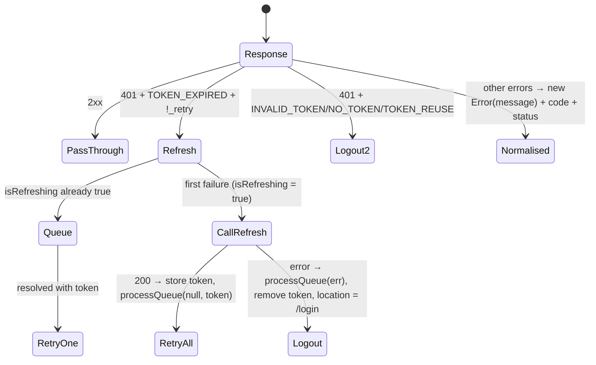

# Part IV-B — Frontend Files, Explained

Order: entry → app shell → API layer → stores → hooks → lib → UI primitives → shared components → pages → config/static files.

---

## 1. `src/main.jsx` (21 lines)

Creates one `QueryClient` (`retry: 1`, `staleTime: 30_000`) and renders `<StrictMode><QueryClientProvider><App/></…>` into `#root`; imports `index.css` (Tailwind). **Why staleTime 30 s:** avoids refetching the same data on every navigation, at the cost of up to 30 s stale views (and it amplifies the key-collision bug, BUG-10).

---

## 2. `src/App.jsx` (262 lines) — application shell

| Block | Lines | What it does |
|---|---|---|
| Lazy pages | 14-23 | `lazy(() => import('./pages/X').then(m => ({ default: m.X })))` — pages use **named** exports, so the promise is mapped to a `default`. |
| `NAV_ITEMS` | 33-40 | Path, label, icon, `allowedRoles`. Doctors see Dashboard + Appointments only. |
| `Layout` | 44-191 | Sidebar (desktop), top bar (bell, profile link, logout), main area with `Suspense`, floating `SmartChatbot`, bottom nav (mobile). Calls `useFCM()` once per mount. `handleLogout`: `POST /auth/logout` (errors ignored) → `clearAuth()` → clear notification store. |
| `AuthVerifier` | 195-222 | On first app load, if persisted `isLoggedIn`, calls `GET /auth/me`; success → `setUser(fresh)`; failure → `clearAuth()`. Renders nothing in both branches (`checking` state is unused for gating). |
| `ProtectedRoute` | 226-229 | `isLoggedIn ? children : <Navigate to="/login" replace/>`. |
| `App` | 233-261 | `BrowserRouter`, `Toaster`, `AuthVerifier`, routes (3 public, 7 protected, `*` → `/`). |

**Data flow on a cold load with a valid persisted session:** persisted Zustand state hydrates synchronously from localStorage → `ProtectedRoute` lets `/dashboard` render → `AuthVerifier` effect fires `/auth/me` in parallel → user object refreshed.

**Interview questions.**
1. *Why is the token check (`/auth/me`) not blocking rendering?* — Faster first paint; trade-off: protected UI may briefly render for an expired session.
2. *Where is role-based access enforced?* — Only in the nav (UI). The API enforces data access via `doctor_id/user_id` filters — except for the admin routes (SEC-01).

---

## 3. `src/api/axios.js` (102 lines) — the most important frontend file for interviews

```js
export const api = axios.create({ baseURL: BASE_URL, withCredentials: true, headers: {'Content-Type':'application/json'} });

api.interceptors.request.use((config) => {
  const token = localStorage.getItem('accessToken');             // read synchronously each request
  if (token) config.headers.Authorization = `Bearer ${token}`;
  config.headers['x-timezone'] = Intl.DateTimeFormat().resolvedOptions().timeZone;  // e.g. "Asia/Kolkata"
  return config;
});
```

**Response interceptor state machine:**



**Details worth explaining.**
- `original._retry = true` prevents infinite refresh loops for the same request.
- The refresh call uses the **bare** `axios.post` (not `api`) so it doesn't pass through these interceptors.
- `api.defaults.headers.common.Authorization` is set but the request interceptor overrides it from localStorage anyway.
- **Bug (BUG-23):** `.catch(Promise.reject)` passes an unbound method → `TypeError: PromiseReject called on non-object` replaces the real error for queued requests.
- After normalisation, errors have no `.response`; code elsewhere reading `err.response?.data?.message` always falls back.

---

## 4. `src/api/*.api.js` (8 files)

Each exports an object of thin wrappers. Mapping and usage are listed in Part VII §7.13. Noteworthy:
- `auth.api.js` also exports `notificationApi`.
- `appointment.api.js` `removeSchedule(id)` sends a **DELETE with a body** (`{ data: { id } }`) — allowed by axios and Express, but some proxies drop DELETE bodies; a path param is more conventional.
- `report.api.js` `upload(formData)` overrides `Content-Type: multipart/form-data` (axios fills in the boundary automatically for `FormData`).
- `diet.api.js` has no `generate` method although `POST /diet/generate` exists.

---

## 5. Stores (Zustand)

### `stores/authStore.js` (41 lines)
`persist` middleware with key `biopulse-auth`, `partialize` keeps `user`, `accessToken`, `isLoggedIn`. `setAuth` also writes `localStorage.accessToken` (for synchronous reads in the interceptor). `clearAuth` removes it. Role helpers `isPatient/isDoctor/isAdmin` (unused).

### `stores/medicineStore.js` (36 lines)
`todaySchedule`, `adherenceStats`; `optimisticLogDose` / `rollbackLogDose` map over `todaySchedule` comparing medicine id and timestamp; derived `pendingCount()`, `takenToday()`. Filled only by the Medicines page's `queryFn`. The Medicines page renders the React Query result, not this store → optimistic update invisible (BUG-16). Dashboard's "dose(s) pending" uses `pendingCount()` → 0 unless Medicines was visited.

### `stores/notificationStore.js` (40 lines)
`notifications` (max 50, newest first with generated ids), `connected`, `markRead`, `markAllRead`, `clear`, `unreadCount()`. Written by `useSocket`; **no component renders it**.

---

## 6. Hooks

### `hooks/useFCM.js` (90 lines)
Guard: logged in, messaging available, not yet registered (ref). Steps: permission → register SW → wait for `activated` (3 s fallback) → `navigator.serviceWorker.ready` → `getToken` with VAPID key → `PUT /auth/fcm-token` → mark registered. Foreground: `onMessage` → `toast.info`. Cleanup unsubscribes. Effect deps `[isLoggedIn]`.
Edge cases: browsers without `Notification`/service workers (Safari iOS without PWA) → caught by `try/catch` but `onMessage` is still attached; empty service worker file (❓ background push).

### `hooks/useSocket.js` (73 lines)
Builds `SOCKET_URL` from env; `io(url, { withCredentials, reconnectionAttempts:5, reconnectionDelay:2000 })`; on connect → `setConnected(true)` and `emit('join', user._id || user.id)`; on `notification` → add to store and invalidate queries by type; cleanup disconnects. Deps `[isLoggedIn, user?._id]`. Problems: used only in Dashboard; mismatched fields/types (BUG-11); no auth token sent (server doesn't check either, SEC-03).

---

## 7. `lib/firebase.js`, `lib/utils.js`

`firebase.js` initialises app + messaging only when `VITE_FIREBASE_API_KEY` is set (otherwise `messaging = null` and `useFCM` exits early); re-exports `getToken`, `onMessage`. `utils.js` → `cn()`.

---

## 8. UI primitives (`components/ui/*`)

| File | Notes |
|---|---|
| `Button.jsx` | `forwardRef`; `variant` (default, destructive, outline, secondary, ghost, link) and `size` maps; base class includes `bg-gray-300` → ghost/link buttons get a grey background. |
| `Card.jsx` | `Card`, `CardHeader`, `CardTitle` (h3), `CardDescription`, `CardContent`, `CardFooter` — all `forwardRef` + `cn`. |
| `Input.jsx`, `Label.jsx` | Styled native elements; `Label` is not tied to inputs via `htmlFor` everywhere (accessibility gap in some forms). |
| `Skeleton.jsx` | `animate-pulse` placeholder. |

---

## 9. Shared components

### `NotificationBell.jsx` (178 lines)
Outside-click close via `mousedown` listener (added only while open, removed in cleanup). `useQuery(['notifications'])` polling every 30 s. `markRead` mutation → invalidate. `markAllRead` → `Promise.all` of N PATCH calls (N round trips; a bulk endpoint would be better). Badge shows `9+`. Item click marks read if unread.

### `SmartChatbot.jsx` (272 lines)
- Hooks are declared before the early `return null` (rule of hooks respected).
- `formatMessage(text)`: replaces `**bold**` with `<strong>`, lines starting `- `/`* ` with `<li>`, wraps `<li>` runs in `<ul>`, `<br/>` for other lines, then **`dangerouslySetInnerHTML`** — no escaping of `<`, `>` or attributes. Any HTML in the model reply (or in the error message string) is rendered → XSS (SEC-06).
- History: last 10 messages (including the greeting) sent to the server.
- `handleQuickAction`: `setTimeout(100)` then sends — reads `messages` from the closure of the render that scheduled it (stale closure is harmless here because it appends via functional `setMessages`).
- Auto-scroll on `[messages, isOpen]`.

**Safe fix 💡:** render Markdown with `react-markdown` (no raw HTML by default) or sanitise with DOMPurify before `dangerouslySetInnerHTML`.

### `Navigation.jsx`, `Footer.jsx`
Landing header with mobile toggle; footer links to non-existent routes.

### `MedicineSchedule.jsx`, `AddMedicineForm.jsx` — unused
Older versions of the medicine UI. `AddMedicineForm`: `food_instruction` `<select>` default `""` fails `z.enum([...]).optional()` (empty string ≠ undefined) and no error is displayed for that field → submit silently does nothing. Good "find the bug" exercise.

---

## 10. Pages

### `pages/Home.jsx` (167 lines)
Static marketing page with Framer Motion. Contains marketing claims ("encrypted", "thousands of users") that the code does not support — **do not repeat them in an interview**.

### `pages/Login.jsx` (122 lines)
`useForm` + `zodResolver(loginSchema)` → `authApi.login` → `res.data.data` → `localStorage.setItem` (also done by `setAuth`) → `setAuth` → toast → navigate `/dashboard`. Error toast shows `"Error: <message>"` because of `err.toString()`. Link to `/forgot-password` (not implemented).

### `pages/Signup.jsx` (176 lines)
Role chooser cards set `role` via `setValue(..., {shouldValidate:true})`; `watch('role')` shows specialisation input for doctors; `.refine` requires specialisation for doctors. Name rule `min(2)` vs server `min(3)` → server returns the generic "Invalid request body" (BUG-03 makes it confusing).

### `pages/Dashboard.jsx` (752 lines)
| Section | Data source | Notes |
|---|---|---|
| `NotificationPanel` | `['notifications']` (shared with bell) | "Clear all" actually marks all read. |
| Stats | reports (`limit 5`), appointments, today schedule | "Reports Uploaded" reads `reportsRes.total` (undefined: total is at `reportsRes.data.total`) → shows at most 5. Doctor "Total Patients" = number of appointments, not unique patients. Health score = `100 − risk_score`. |
| Doctor live queue | `['doctorQueue', user._id]`, 30 s polling | Call In / Done / No-show buttons → `PATCH /:id/queue-status`. |
| Patient queue tracker | `['doctorQueue', doctorId]` for today's appointment | Shows "patients ahead = token − active − 1", wait ≈ 15 min per token. Exposes other patients' names in the API response (SEC-07). |
| Recent reports / My patients | — | Doctor patient list derived from appointments via `Set` of `user_id._id`. |
| Upcoming appointments, Today's medicines | — | |
| `useSocket()` | — | Only place sockets connect. |

### `pages/Medicines.jsx` (441 lines)
- `MedicineModal` (add/edit): react-hook-form defaults from the medicine; dates converted with `toISOString().split('T')[0]` (UTC date — can be off by one day for users east/west of UTC near midnight); `times` CSV → array; `end_date || undefined`.
- `DoseButton`: dropdown only for pending items; `onBlur` closes when focus leaves the container; mutation with optimistic store update (invisible) and rollback; invalidates `todaySchedule` + `adherence`.
- `AdherenceCard`: `['adherence']`, shows overall % with colour bands (≥80 green, ≥50 amber).
- Main: two queries (`retry:false`), schedule refetch every 60 s, full-page error state with reload button, delete with `window.confirm`.

### `pages/Appointments.jsx` (1188 lines) — biggest page
| Component | Role | Notes |
|---|---|---|
| `RescheduleModal` | Patient picks a new free slot | Uses `appointment.doctor?._id || appointment.doctor_id` → list data has **populated** `doctor_id` object → URL `/doctors/[object Object]/schedules` → 400 → "No available slots found" (BUG-08). Fix: `appointment.doctor_id?._id ?? appointment.doctor_id`. |
| `DoctorBookingModal` | Date chips + slot grid with "x left", disabled past/full | `setSelectedDate` during render; `new Date('YYYY-MM-DD')` UTC parse for display. |
| `AppointmentsPage` | Queries doctors (patients only) + appointments; cancel/book/reschedule/status mutations; search + specialty filter (client-side name/spec filter + server exact-match filter) | Specialty list is hard-coded. |
| `DoctorSlotManager` | Create schedule form (date, duration, start, end, capacity) + list with capacity bars | `min` date uses UTC date. |
| `WritePrescriptionModal` | Template loader, diagnosis, symptoms CSV, dynamic medicine rows, advice, "save as template" | `is_template: true` turns the real prescription into a template (BUG-14). |
| `PatientHistoryModal` | Tabs: profile, reports, prescriptions, medicines | Reads `chronic_conditions` (never saved). |

### `pages/Prescriptions.jsx` (294 lines)
List with client-side search; `PrescriptionDetailModal` fetches `GET /prescriptions/:id`, shows doctor header, patient block, Rx table, advice, signature. `handlePrint` injects a print stylesheet that hides `.no-print` — but the modal root itself has `no-print`, so the prescription is hidden in the printout (BUG-21). Unused variables `printContent`, `originalContent`.

### `pages/Reports.jsx` (654 lines)
- `useReportPolling(id, enabled)`: `refetchInterval` callback misuse + envelope mismatch (BUG-09) — see Part III-B §3B.5.
- `toArray(val)`: coerces strings to arrays (defensive against LLM output variety).
- `ReportCard`: OCR/AI badges, risk chip, re-analyse/delete buttons, stuck banner, spinner, failure banners, summary, urgency banner, key findings grid, expandable full analysis.
- `ExpandedInsights` (class error boundary) with renderers for risks, diet, exercise, doctor recommendations; disclaimer.
- Upload form: file input (`accept` pdf/jpg/png), type select, `FormData` with `report_date` = now.
- All LLM text is rendered as React text (escaped) — safe here, unlike the chatbot.

### `pages/Diet.jsx` (822 lines)
`ProgressRing` (SVG `strokeDasharray/strokeDashoffset` maths), `FoodSearchModal` (manual + USDA search with `['foodSearch', q]` — a request per keystroke ≥2 chars, no debounce), `DietChatbot` (sends full history; strips `**`), `RecommendationsPanel` (one-click add), `WeeklyNutritionTrends` (`plan.history` → always empty), `TodayFoodLog` (per-meal totals, "High Calorie" > 2000, remove on hover), page-level macro % (share of grams, not of calories), hydration counter (local state only, lost on reload), "LIMIT EXCEEDED" at > 5000 kcal while the server caps at 4000.

### `pages/Profile.jsx` (411 lines)
Role-specific fields; `reset(buildDefaults(user))` when `user` changes; submit strips empty strings and converts numeric fields; on success sets user from response and re-fetches `/users/me`; password modal with confirm validation. Allergies/conditions are not editable here; no delete-account UI.

---

## 11. Styles and static files

| File | Notes |
|---|---|
| `index.css` | Tailwind v4 `@theme` mapping CSS variables → colour utilities; light + `.dark` palettes; `@apply border-border`, body background/foreground; `.shadow-soft`, `.shadow-soft-md`. |
| `App.css` | Template CSS (counter/hero) — not imported. |
| `index.html` | Title "BioPulse Healthcare"; Google Fonts Inter (third-party request on every load). |
| `public/firebase-messaging-sw.js` | Empty (0 bytes). |
| `public/favicon.svg` | Vite logo. |

---

## 12. Frontend interview questions (file-based)

1. *Explain how `axios.js` prevents multiple simultaneous refresh calls.* (Single-flight flag + promise queue.)
2. *Why does the Reports page keep polling a failed report?* (v5 `refetchInterval(query)` + envelope mismatch; `analysis_status` stays `pending` when OCR fails, so `enabled` stays true until the 5-minute cut-off.)
3. *Find the bug in `RescheduleModal`.* (Populated object in URL.)
4. *Why is `ExpandedInsights` a class?* (Error boundary.)
5. *What's the XSS path in the chatbot, and why does localStorage make it worse?* (Unsanitised HTML; token theft.)
6. *Why does Medicines sometimes show "No doses scheduled" right after visiting the Dashboard?* (Query-key collision with different shapes + 30 s staleTime.)
7. *How would you debounce the food search?* (`useDeferredValue` or a 300 ms debounced state as the query key.)
8. *What does `markModified` do on the server for diet plans, and why is it needed?* (Mongoose can't detect deep mutations inside nested/mixed paths.)
