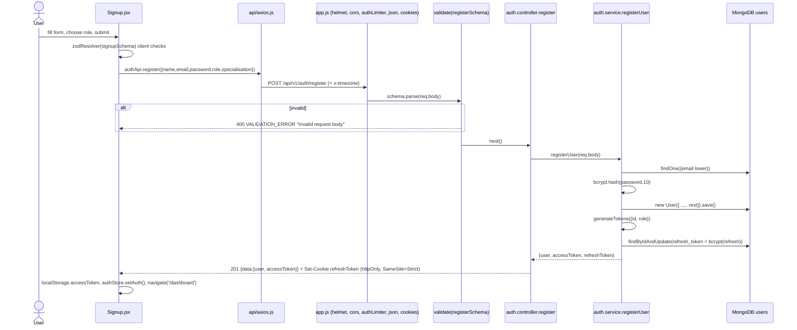
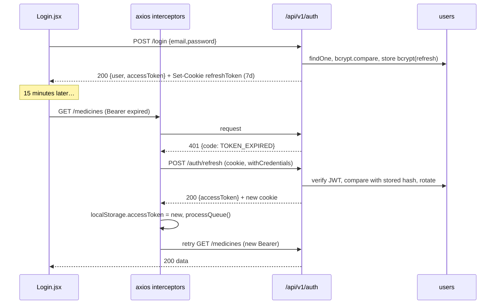
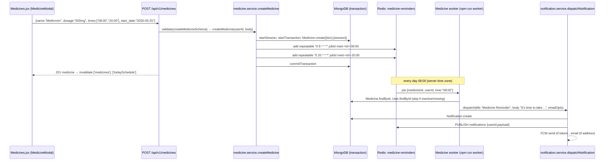
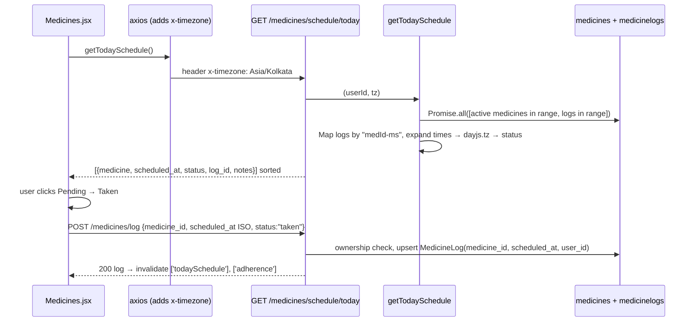
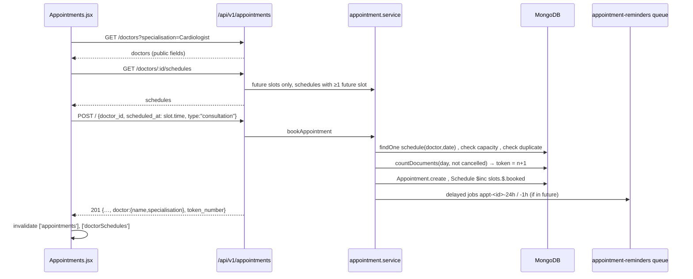
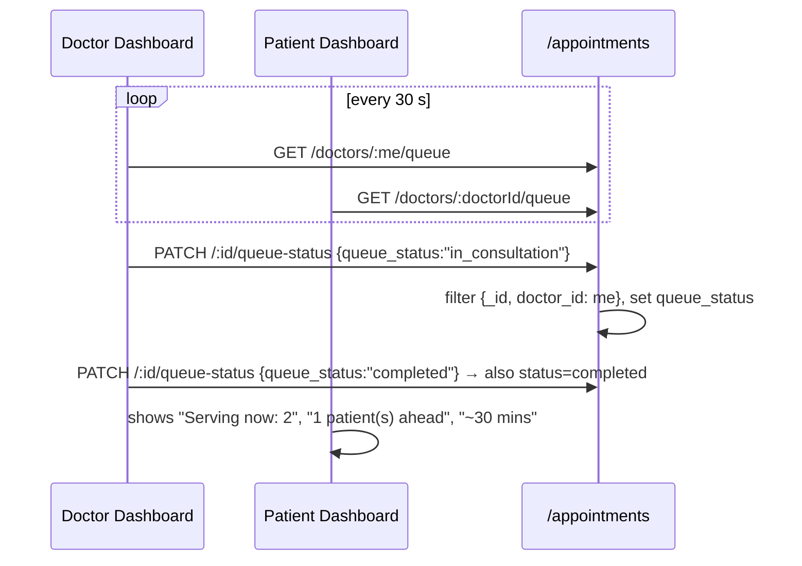
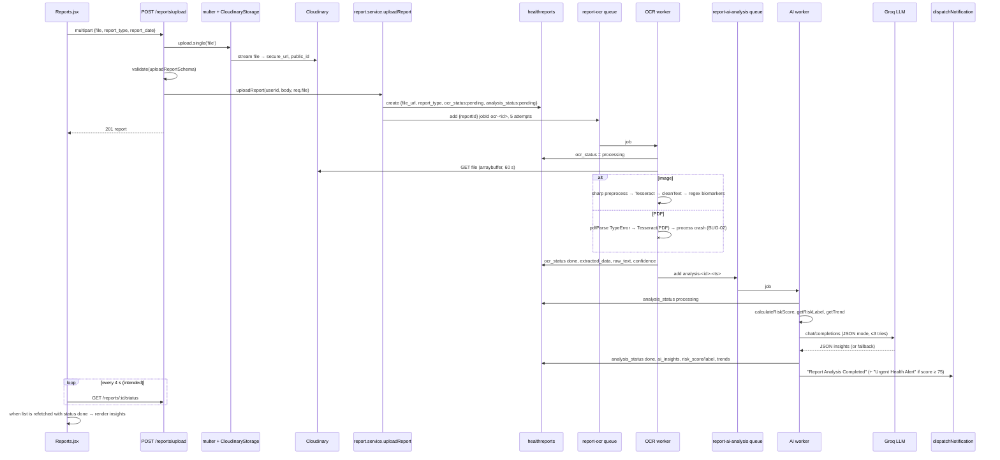
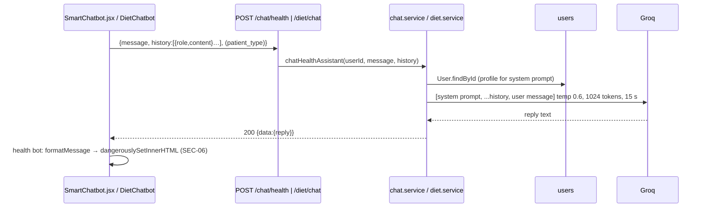

# Part V — End-to-End Feature Workflows

Each workflow: **trigger → files/functions in order → request/response → DB/Redis effects → errors → auth → async/concurrency → performance → how to test.** Diagrams are Mermaid (render on GitHub).

---

## 5.1 Registration

- **Request:** `{"name":"Asha Rao","email":"asha@x.com","password":"secret12","role":"patient"}`
- **Response 201:** `{"success":true,"message":"User registered successfully","data":{"user":{"_id":"…","name":"Asha Rao","email":"asha@x.com","role":"patient","conditions":[],"allergies":[],"createdAt":"…"},"accessToken":"eyJ…"}}`
- **Errors:** 400 validation (generic message, BUG-03), 400 `EMAIL_EXISTS`, 400 `DUPLICATE_ERROR` (race on unique index), 429 after 20 auth calls/15 min/IP.
- **Security notes:** `role:'admin'` silently becomes patient ✓; extra body keys are saved if they are schema fields (SEC-11).
- **Test:** supertest — valid register sets cookie and returns no `password_hash`; duplicate email → 400; `role:'admin'` → role patient; unknown key `password_hash` is ignored (after fix).

---

## 5.2 Login, app reload and silent token refresh

- **Cold reload:** Zustand rehydrates `isLoggedIn` → `AuthVerifier` calls `GET /auth/me`; 401 `NO_TOKEN/INVALID_TOKEN` → redirect to `/login` and `clearAuth()`.
- **Concurrency:** many 401s at once → one refresh (queue). Server side, two tabs refreshing at the same time can race: tab A rotates, tab B presents the old token → expected "reuse" → but bcrypt truncation makes it match anyway (SEC-05), so in practice both succeed.
- **Production cookie caveat:** `SameSite=Strict` cookies are not sent on cross-site requests. If the SPA and API are on different registrable domains (e.g. `*.vercel.app` and `*.onrender.com`), `/auth/refresh` gets no cookie → 401 → user logged out every 15 min. Same-site subdomains (`app.example.com` / `api.example.com`) work.
- **Test:** expire token with fake timers / short expiry; assert one refresh call for three parallel requests (MSW on the frontend); server: old refresh token must be rejected after rotation (fails today).

---

## 5.3 Logout and password change

`Layout.handleLogout` → `POST /auth/logout` (authenticated) → `refresh_token = null` → `clearCookie` → frontend `clearAuth()` + clear notifications. The access token remains valid until expiry (stateless). Password change → verify current → hash new → clear refresh hash → clear cookie → UI toasts "Please log in again" but does **not** log the user out locally (next refresh fails → redirect).

---

## 5.4 Add a medicine → recurring reminders → notification fan-out

- **Preconditions:** the worker process must be running (`npm run worker`), because `server.js` never starts workers (BUG-01, 🔬).
- **Time zone:** cron patterns run in the worker's time zone (`tz: null`, 🔬 V13). Server in UTC + user in India → 08:00 reminder arrives at 13:30 IST.
- **Edit times:** old schedulers are not removed (🔬 V13) → user gets reminders at both old and new times (both pass the `is_active` check).
- **Failure handling:** if the transaction commit fails after jobs were added → orphan reminders whose worker finds no medicine → skipped (safe but wasteful).
- **Test:** unit-test `parseTimeToCron`, `buildJobId`; integration with real Redis: create, update times, assert `getJobSchedulers()` (after fix) contains only new times.

---

## 5.5 Today's schedule and logging a dose

- **Key design:** the log key uses the exact scheduled timestamp, so the client must send back `scheduled_at` exactly as received (it does: `new Date(item.scheduled_at).toISOString()`).
- **Optimistic UI:** writes to Zustand, page renders React Query → no visible optimism (BUG-16).
- **Concurrency:** double-click could create two logs without a unique index.
- **Test:** schedule across a DST-observing zone (e.g. `America/New_York` on a DST change day) and across midnight boundaries.

---

## 5.6 Doctor creates a schedule

`DoctorSlotManager.handleCreate` → `POST /appointments/doctors/schedules {date, start_time, end_time, slot_duration:int, max_patients:int}` → `validate(addScheduleSchema)` → `addDoctorSchedule(req.userId, body)` → doctor check → `date-fns.parse` (server TZ) → generate future slots → "already exists" check → `Schedule.create` → `200 "Schedule created with N slots"` → invalidate `['doctorSchedules']`.
Errors: invalid time format, end ≤ start, past schedule, no future slots, duplicate date, not a doctor (404).
Dry run in Part IV-A (2/2) §4.

---

## 5.7 Patient books an appointment

- **Race:** capacity and token are check-then-act (BUG-07). Atomic fix in Part IV-A (2/2) §4.
- **Reminder accuracy:** a delayed job created long in advance survives restarts (stored in Redis); rescheduling removes and recreates by id.
- **Test:** fire 10 parallel bookings at a slot with capacity 2 → expect exactly 2 successes and tokens 1..2 unique (fails today).

---

## 5.8 Reschedule and cancel

**Reschedule (UI broken, BUG-08):** `RescheduleModal` → `GET /doctors/[object Object]/schedules` → 400 → "No available slots". If called directly via API: requires `status 'scheduled'` → decrement old slot, increment new, remove + re-add reminders, `status='rescheduled'`, token unchanged.
**Cancel:** `DELETE /appointments/:id` → role filter → reject if already cancelled → decrement slot → `status='cancelled'` → remove reminders → `{cancelled:true}`. The appointment worker also skips cancelled appointments (defence in depth if job removal failed).

---

## 5.9 Live clinic queue

Real-time is achieved by **polling** (30 s), not sockets. Worst-case staleness 30 s. Privacy: queue response includes all patients' names (SEC-07).

---

## 5.10 Prescription writing and viewing

Doctor: `WritePrescriptionModal.handleSubmit` → client checks (diagnosis, medicine fields) → `POST /prescriptions {patient_id, appointment_id, diagnosis, symptoms[], medicines[], advice, is_template, template_name}` → `createPrescription` → appointment must belong to doctor → `Prescription.create` → appointment `completed` → populate → 201 → invalidate `['appointments']`.
Patient: `Prescriptions.jsx` → `GET /prescriptions/patient` (non-templates) → click → `GET /prescriptions/:id` (role filter) → print.
Defects: template checkbox hides the real prescription (BUG-14); `patient_id` not cross-checked (SEC-08); print hides content (BUG-21).

---

## 5.11 Health report: upload → OCR → AI → notification → UI (the flagship flow)

- **Statuses:** `ocr_status` and `analysis_status` each `pending → processing → done|failed` (state machine in Part IX).
- **What the user actually sees today:** card shows "Extracting text…" until the reports list is refetched (focus, navigation, 30 s staleness) because the status poller reads the wrong level (BUG-09). PDFs never finish (BUG-02).
- **Retries:** OCR download failures retry 5× with exponential backoff (3 s, 6 s, 12 s, 24 s); Groq failures are retried inside the job (3×) and then replaced by a fallback JSON marked `done`.
- **Idempotency:** OCR job id is deterministic (`ocr-<id>`) → duplicate upload jobs collapse; AI job id is not.
- **Performance:** OCR concurrency 2 per worker process; Tesseract spawns a worker per call; Groq call up to 45 s × 3.
- **Privacy:** OCR text and biomarkers go to Groq; OCR preview is logged.
- **Test:** unit-test extraction with fixture texts (Hemoglobin spelling, µmol/L, VLDL before LDL); integration test the OCR processor function with a fixture PNG; contract test the AI JSON with a Zod schema; e2e: upload → poll → done.

---

## 5.12 Diet: add food (manual, search or recommendation)

`FoodSearchModal` / `RecommendationsPanel` → `addMealMutation.mutate({mealType, item})` → `POST /diet/meal {meal_type, items:[item]}` → `validate(addCustomMealSchema)` → `addCustomMealToPlan` → get active plan (create "Today" plan if none) → normalise macros/calories → daily cap 4000 → push → warnings → `markModified` → save → response with `auto_recommendations` and `manual_warnings` → frontend toasts warnings → invalidate `['dietPlan']`.
Search: `GET /diet/search?q=` → USDA (8 s timeout, 2 tries) → mapped list (per 100 g).
Remove: `DELETE /diet/meal/:meal_type/:itemId`.
Defects: never-resetting "Today" (BUG-15); macros override calories; per-keystroke search.

---

## 5.13 AI chat (health assistant and dietitian)

No streaming (user waits for the full reply), no conversation persistence, no per-user quota.

---

## 5.14 Notification delivery paths (who sees what)

| Path | Mechanism | Works today? |
|---|---|---|
| DB → bell/panel | `Notification` documents, `GET /notifications` every 30 s | ✅ |
| Redis pub/sub → Socket.IO → `useSocket` | `PUBLISH notifications` → relay in `server.js` → `io.to(userId)` | ❌ relay never subscribes (BUG-01); client only on Dashboard; wrong fields (BUG-11); unauthenticated rooms (SEC-03) |
| FCM push | `firebase-admin` → device token from `useFCM` | ❓ foreground toasts plausible with keys; background needs a real service worker |
| Email | Nodemailer per notification | ❓ needs SMTP; every reminder sends an email |

---

## 5.15 Meal reminders (cron)

`cron.js` at 08:00/13:00/19:00 IST → `dietReminderQueue.add({mealName})` → diet worker → `User.find({is_banned:false})` → **0 users** (🔬 V10) → "Done processed: 0". If fixed: N users × (DB insert + publish + push + email) sequentially, multiplied by the number of API instances running cron.

---

## 5.16 Profile update

`Profile.onSubmit` → strip empty strings, cast numbers → `PATCH /users/me` → `validate(updateProfileSchema)` → `updateUserProfile(userId, role, body)` → copy allowed fields only → `findByIdAndUpdate` (strict mode drops undeclared fields) → response user → `setUser` → `GET /users/me` → `setUser` again → toast.
Note: the frontend cannot clear a field (empty strings are stripped) — a deliberate safety choice with a usability cost.

---

## 5.17 Doctor views a patient's medical history

`PatientHistoryModal` → `GET /users/:userId/history` → `getPatientHistory` (4 sequential queries) → tabs. Authorisation is missing: any authenticated user can request any user's history (SEC-01). Correct rule 💡: allow admin, the patient themself, or a doctor who has (or had) an appointment with the patient.
