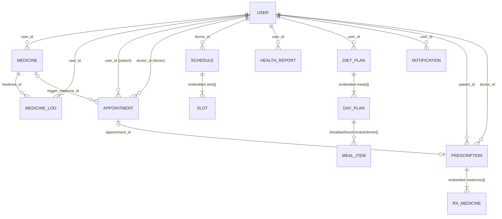

# Part VI — Database and Data Models (MongoDB + Mongoose)

## 6.1 Connection lifecycle

| Step | Code | Notes |
|---|---|---|
| Connect | `config/db.js` → `mongoose.connect(env.DATABASE_URL)` | Default pool `maxPoolSize: 100`; `serverSelectionTimeoutMS: 30000`. On failure → `process.exit(1)`. |
| Second connect in workers | `workers/index.js:98` | Same URI → Mongoose reuses the connection (no error). |
| Command buffering | Mongoose default | Queries issued before connection are buffered for 10 s, then fail ("buffering timed out", seen in 🔬 V11). |
| Disconnect | `server.js:95-97` during shutdown | Workers process (`npm run worker`) has no shutdown handler. |
| Transactions | `medicine.service.js` | Require replica set (MongoDB Atlas is one). Local standalone `mongod` → create/update medicine fails. |

---

## 6.2 Entity-relationship diagram



Relationships are **references by ObjectId**, resolved with `populate`. No foreign-key enforcement: deleting a user leaves all related documents orphaned.

Embedding vs referencing decisions:
- **Embedded:** slots inside a schedule (always read/updated together, bounded size), meal items inside a diet plan, medicines inside a prescription (immutable snapshot — correct for medical records).
- **Referenced:** users ↔ appointments/reports/medicines (unbounded, queried independently).

---

## 6.3 Models — every field

### `User` (`models/User.js`)
| Field | Type | Rules | Used for |
|---|---|---|---|
| `name` | String | required | everywhere |
| `email` | String | unique, sparse | login (lower-cased in service) |
| `phone` | String | unique, sparse | doctor contact; uniqueness means two doctors can't share a clinic phone |
| `password_hash` | String | required | bcrypt hash |
| `refresh_token` | String | — | bcrypt hash of current refresh token |
| `role` | String | enum patient/doctor/admin, default patient | authZ |
| `fcm_token` | String | — | push |
| `avatar_url` | String | — | UI |
| `age`, `height`, `weight`, `calorie_goal` | Number | — | BMR, profile |
| `gender` | String | enum male/female/other | BMR |
| `blood_group` | String | enum 8 values | profile |
| `specialisation`, `qualification`, `bio`, `clinic_address` | String | — | doctor profile |
| `experience_years`, `consultation_fee` | Number | — | doctor profile |
| `conditions` | [String] | default [] | read by chat/diet (`chronic_conditions || conditions`) — but no API writes it |
| `allergies` | [String] | default [] | chat prompt, diet restrictions |
| `createdAt`, `updatedAt` | Date | timestamps | |

**Written by code but NOT declared (silently dropped, 🔬 V10):** `is_banned`, `last_login`, `permissions`, `chronic_conditions`, `emergency_contact`. **Read by code but never written:** `goal`, `patient_type`.

### `Medicine` (`models/Medicine.js`)
`user_id` (ref User, required), `name` (req), `dosage` (String, req), `unit`, `frequency`, `times` ([String], req), `food_instruction`, `start_date` (Date, default now), `end_date`, `days_supply`, `notes`, `is_active` (default true), timestamps.

### `MedicineLog` (same file)
`medicine_id` (ref, req), `user_id` (ref, req), `scheduled_at` (Date, req), `taken_at`, `status` (enum pending/taken/missed/skipped/snoozed, default pending), `notes`, timestamps.

### `Appointment`
`user_id` (ref, req), `doctor_id` (ref, req), `scheduled_at` (Date, req), `type` (String, req), `notes` (default ''), `status` (enum scheduled/confirmed/rescheduled/completed/cancelled/no_show; default scheduled — `confirmed` is never set), `token_number` (Number), `queue_status` (enum waiting/in_consultation/completed/no_show, default waiting), `auto_booked` (default false), `trigger_medicine_id` (ref Medicine), timestamps.

### `Schedule`
`doctor_id` (ref, req), `date` (**String** `YYYY-MM-DD`, req), `start_time`/`end_time` (String `HH:mm`, req), `slot_duration` (Number ≥5, req), `max_patients` (Number ≥1, default 1), `slots` ([{ `time`: Date req, `booked`: Number default 0, `_id` }]), timestamps.
Why `date` is a string: easy equality lookup "schedule for this day" — but the day is interpreted in the server's time zone.

### `HealthReport`
`user_id` (ref, req), `file_url` (req), `file_type`, `content_type`, `report_type` (String req — no enum at DB level), `report_date` (default now), `ocr_status` (enum, default pending), `extracted_data` (Mixed), `raw_text`, `extraction_confidence`, `analysis_status` (enum, default pending), `ai_summary` (max 50,000 chars), `ai_insights` / `ai_flags` / `ai_recommendations` / `trends` (Mixed), `risk_score` (0–100), `risk_label` (enum minimal/low/moderate/high/critical), `error_message`, timestamps.
Not declared (dropped): `ocr_started_at`, `ocr_attempt`, `ocr_completed_at`, `extraction_method`, `analysis_started_at`, `analysis_completed_at`. `ai_flags`, `ai_recommendations` are never written.
Note: `ai_summary` stores the full JSON string (up to ~3,000 tokens ≈ 12 kB) — `maxlength 50000` would turn an unusually long model output into a `ValidationError`… except `findByIdAndUpdate` doesn't run validators by default, so the limit isn't enforced on that path.

### `DietPlan`
`user_id` (ref, req), `week_start` (Date, req), `total_calories` (req), `patient_type` (default general), `goal`, `bmr`, `notes`, `ai_generated` (default false), `meals` ([`dayPlanSchema`: `day` String, `meals:{breakfast,lunch,snack,dinner: [mealItemSchema]}`, `_id:false`]), `is_active` (default true), timestamps.
`mealItemSchema`: `name` (req), `calories` (req), `macros{protein,carbs,fat}` (default 0), `quantity` (default 1), auto `_id` (used to delete an item).
Dropped on save: day-level `restrictions` (from `generateMeals`), item-level `meal_type`, `notes`.

### `Notification`
`user_id` (ref, req, **indexed**), `title`, `body` (req), `type` (enum appointment/medicine/diet/report/system/low_stock), `metadata` (Mixed, default {}), `is_read` (default false), timestamps. **TTL index** `{createdAt:1}, expireAfterSeconds: 2,592,000` (30 days) — MongoDB's TTL monitor deletes expired docs roughly every 60 s.

### `Prescription`
`patient_id` (req), `doctor_id` (req), `appointment_id` (optional — templates), `diagnosis` (req), `symptoms` ([String]), `medicines` ([{ name, dosage, frequency, duration (all req), instructions default '' }]), `advice`, `is_template` (default false), `template_name`, timestamps. Templates set `patient_id = doctor_id` to satisfy `required` — a modelling smell; a separate `PrescriptionTemplate` collection is cleaner.

---

## 6.4 Every important query

| # | Location | Query | Index used today | Recommended index 💡 | Notes |
|---|---|---|---|---|---|
| Q1 | auth login/register | `users.findOne({email})` | `email` unique ✅ | — | Lower-cased in code. |
| Q2 | many | `users.findById(id)` | `_id` ✅ | — | |
| Q3 | doctors list | `users.find({role:'doctor', specialisation?})` | none (COLLSCAN) | `{role:1, specialisation:1}` | Exact match; case-sensitive. |
| Q4 | admin list | `find(filter).sort({createdAt:-1}).skip().limit()` + `count` | none | `{role:1, createdAt:-1}` | Skip pagination degrades with depth. |
| Q5 | medicines list | `medicines.find({user_id, is_active:true}).sort({createdAt:-1})` | none | `{user_id:1, is_active:1, createdAt:-1}` | |
| Q6 | today schedule | `find({user_id, is_active, start_date ≤ end, $or:[end_date null, end_date ≥ start]})` | none | `{user_id:1, is_active:1}` | `$or` with null matches missing too. |
| Q7 | dose logs day/period | `medicinelogs.find({user_id, scheduled_at range})` | none | `{user_id:1, scheduled_at:1}` | |
| Q8 | dose upsert | `findOneAndUpdate({medicine_id, scheduled_at, user_id}, …, {upsert:true})` | none | **unique** `{medicine_id:1, scheduled_at:1}` (+user) | Prevents duplicate logs under concurrency. |
| Q9 | user appointments | `appointments.find({user_id|doctor_id}).populate×2.sort({scheduled_at:1})` | none | `{user_id:1, scheduled_at:1}`, `{doctor_id:1, scheduled_at:1}` | Returns full history unpaginated. |
| Q10 | duplicate booking | `findOne({user_id, doctor_id, scheduled_at, status:$nin})` | none | covered by `{doctor_id:1, scheduled_at:1}` | |
| Q11 | token count | `countDocuments({doctor_id, scheduled_at range, status≠cancelled})` | none | `{doctor_id:1, scheduled_at:1}` | Race → use counter. |
| Q12 | doctor queue | same range + `populate(user_id,'name').sort({token_number:1})` | none | `{doctor_id:1, scheduled_at:1}` | |
| Q13 | schedule for day | `schedules.findOne({doctor_id, date})` | none | **unique** `{doctor_id:1, date:1}` | Prevents duplicate schedules per day. |
| Q14 | slot increment | `findOneAndUpdate({_id, 'slots._id'}, {$inc:{'slots.$.booked':n}})` | `_id` ✅ | — | Atomic within one document. |
| Q15 | reports list | `healthreports.find({user_id, report_type?}).sort({report_date:-1}).skip.limit` + count | none | `{user_id:1, report_date:-1}` | |
| Q16 | report by id + owner | `findOne({_id, user_id})` | `_id` ✅ | — | Ownership check in the filter = good IDOR defence. |
| Q17 | trends | `find({user_id, 'extracted_data.<path>': {$exists:true}}).sort({report_date:1}).select(path)` | none | `{user_id:1, report_date:1}` | Path validated by regex. |
| Q18 | AI trend | `find({user_id, ocr_status:'done'}).sort({createdAt:-1}).limit(5)` | none | `{user_id:1, ocr_status:1, createdAt:-1}` | |
| Q19 | patient history | 4 sequential finds | none | as above | Parallelise. |
| Q20 | notifications | `find({user_id}).sort({createdAt:-1}).limit(50)` | `user_id` ✅ (then in-memory sort) | `{user_id:1, createdAt:-1}` | Polled every 30 s by every open tab → hottest query. |
| Q21 | mark read | `findOneAndUpdate({_id, user_id}, {is_read:true})` | `_id` ✅ | — | |
| Q22 | prescriptions patient/doctor | `find({patient_id|doctor_id, is_template})` | none | `{patient_id:1, createdAt:-1}`, `{doctor_id:1, is_template:1}` | |
| Q23 | active diet plan | `findOne({user_id, is_active:true}).sort({createdAt:-1})` | none | `{user_id:1, is_active:1}` | Could enforce one active plan with a partial unique index `{user_id:1}` where `is_active:true`. |
| Q24 | deactivate plans | `updateMany({user_id, is_active:true}, {$set:{is_active:false}})` | none | same | Not atomic with the following create (two quick generates → two active plans). |
| Q25 | diet worker | `users.find({is_banned:false}).select().skip().limit(100)` | none | — | Matches nothing (🔬). |
| Q26 | FCM cleanup | `users.updateOne({fcm_token}, {$unset})` | none | `{fcm_token:1}` sparse | Rare. |

**How to verify an index is used:** `db.medicinelogs.find({user_id:…, scheduled_at:{$gte:…}}).explain('executionStats')` → look for `IXSCAN` vs `COLLSCAN` and `totalDocsExamined` ≈ `nReturned`.

**Declaring indexes in Mongoose 💡:**
```js
medicineLogSchema.index({ medicine_id: 1, scheduled_at: 1 }, { unique: true });
medicineLogSchema.index({ user_id: 1, scheduled_at: 1 });
scheduleSchema.index({ doctor_id: 1, date: 1 }, { unique: true });
appointmentSchema.index({ doctor_id: 1, scheduled_at: 1 });
appointmentSchema.index({ user_id: 1, scheduled_at: 1 });
healthReportSchema.index({ user_id: 1, report_date: -1 });
notificationSchema.index({ user_id: 1, createdAt: -1 });
```
(Mongoose `autoIndex` builds them at startup; in production prefer building them deliberately, e.g. via a migration script, because index builds consume resources.)

---

## 6.5 Data validation and integrity

| Layer | What it checks | Gaps |
|---|---|---|
| Zod (request) | Shapes on 17 routes | Parsed output discarded; params/query not validated; prescriptions/chat unvalidated. |
| Services | Business rules (future dates, capacity, ownership, macro sanity, 4000 kcal) | Race conditions; inconsistent error codes. |
| Mongoose schema | Required fields, enums, min/max on save/create | Update queries skip validators unless `runValidators:true`; strict mode drops unknown fields silently. |
| MongoDB | Unique `email`/`phone`; TTL | No other constraints. |

**Integrity issues to discuss:** orphaned documents on account deletion; `patient_id` vs `appointment.user_id` mismatch possible; slot `booked` counter can drift from the real number of appointments (races, cancelling completed appointments); multiple active diet plans possible.

**Reconciliation idea 💡:** a nightly job recomputes `slots.booked` from appointments (`$group` by `doctor_id, scheduled_at`) and alerts on drift.

---

## 6.6 Transactions and concurrency

| Operation | Today | Risk | Better |
|---|---|---|---|
| Create medicine | Transaction (single insert!) + BullMQ add | Transaction adds latency and a replica-set requirement for a single-document write (single-document writes are already atomic). | Drop the transaction, or use an outbox. |
| Update medicine | Transaction + double abort bug | 500s on not-found/invalid time (BUG-06) | Abort once; validate before mutating. |
| Book appointment | 4 separate operations | Overbooking, duplicate tokens | Conditional `$inc` + counter + unique index (or a transaction with `readConcern: snapshot` on a replica set). |
| Reschedule | decrement old, increment new, save | Partial failure leaves counts wrong | Transaction or compensation. |
| Dose log upsert | upsert without unique index | Duplicate logs | Unique compound index (MongoDB retries the upsert on duplicate key). |
| Diet "add meal" | read-modify-write of the whole plan | Lost update if two tabs add at once (last `save` wins on the nested array? — Mongoose's `save` sends `$set` of the modified path, `markModified('meals')` sets the whole `meals` array → the second save overwrites the first's item) | Use `$push` on `meals.0.meals.<type>` or optimistic concurrency (`optimisticConcurrency: true` uses `__v`). |
| Report re-analyse | status check then update | Two jobs | `findOneAndUpdate({_id, analysis_status:{$ne:'processing'}}, {analysis_status:'pending'})` as a compare-and-set. |

**Interview phrase:** "Wherever I had *read → check → write*, two requests can interleave. The fix pattern is to make the check part of the write — a conditional update or a unique index — so MongoDB arbitrates atomically."

---

## 6.7 Pagination and filtering

Implemented: reports (`page`, `limit ≤ 50`, `report_type`), users (`page`, `limit ≤ 100`, `role`), diet history (`page`, `limit`). Not paginated: appointments, medicines, prescriptions, notifications (limit 50, no page). Technique: `skip/limit` (offset). For large collections, **keyset pagination** (`{report_date < lastSeen}` with an index) is O(page size) instead of O(offset).

---

## 6.8 Database security and access control

- Every user-owned query includes `user_id`/`doctor_id` from the **token** (not the body) → good IDOR protection for most routes. Exceptions: `/reports/patient/:patientId`, `/users/:userId*`, `/appointments/doctors/:id/queue` (SEC-01, SEC-02, SEC-07).
- NoSQL injection: Express 5's JSON parser can produce objects, e.g. `{"email":{"$gt":""}}`. Login has a Zod `email` string check (rejects objects) ✅. Routes without validation pass body fields into queries: e.g. `cancelAppointment` uses `req.params.id` (string) ✅; `createPrescription` uses `appointment_id` from the body in `findOne({_id: appointment_id, doctor_id})`. Mongoose **allows query operators in filters**, so `"appointment_id": {"$ne": null}` would match one of the doctor's own appointments; the following `Prescription.create` then fails to cast that object to an ObjectId, so nothing is saved (🔬 both behaviours checked offline with the project's Mongoose) — no damage here, but the pattern is unsafe (a String field would be fully injectable). Recommendation: validate every body with Zod (`z.string().regex(/^[0-9a-f]{24}$/)`) and/or `mongoose.set('sanitizeFilter', true)`, which strips `$`-prefixed keys from filters.
- PHI at rest: OCR raw text, biomarkers, AI insights stored unencrypted at field level (encryption at rest depends on the hosting, e.g. Atlas encrypts disks). Consider field-level encryption for `raw_text`.
- Least privilege: one DB user with full rights (❓ deployment); use a role limited to the app database.

---

## 6.9 Schema changes, migrations, backups, recovery

- **Exists:** nothing — no migration tool, no seed scripts, no backup scripts.
- **Schema drift evidence:** fields added in code without schema updates (BUG-04) — exactly what a migration discipline and `strict:'throw'` in development prevent.
- **Recommended 💡:**
  - Migrations with `migrate-mongo` (e.g. add `is_banned:false` to all users, backfill `timezone`).
  - Backups: Atlas continuous backup with point-in-time restore; test restores quarterly.
  - Redis: BullMQ state is operational, but delayed reminders live **only** in Redis → enable AOF persistence or be able to rebuild reminders from MongoDB (reconciliation job).
  - Data retention policy for medical data (notifications TTL exists; reports/raw text need one).

---

## 6.10 Interview questions on the data layer

1. *Why is `Schedule.date` a string?* — Exact-day equality lookups without time-zone maths; trade-off: the day is implicitly in the server's zone.
2. *Why embed slots?* — A schedule and its slots are read together; positional `$inc` updates one slot atomically within one document.
3. *How does the dose log avoid duplicates and when does it fail?* — Upsert keyed by medicine+time+user; without a unique index concurrent upserts can both insert.
4. *What does a TTL index cost?* — A background thread deletes expired docs about once a minute; deletes are not instant, and the index adds write overhead.
5. *What would you index first?* — `notifications {user_id, createdAt}` (polled constantly), then `medicinelogs {user_id, scheduled_at}`, `appointments {doctor_id, scheduled_at}`, `schedules {doctor_id, date}` unique.
6. *How would you find the strict-mode bugs automatically?* — `mongoose.set('strict','throw')` in dev/test, and integration tests asserting persisted fields.
