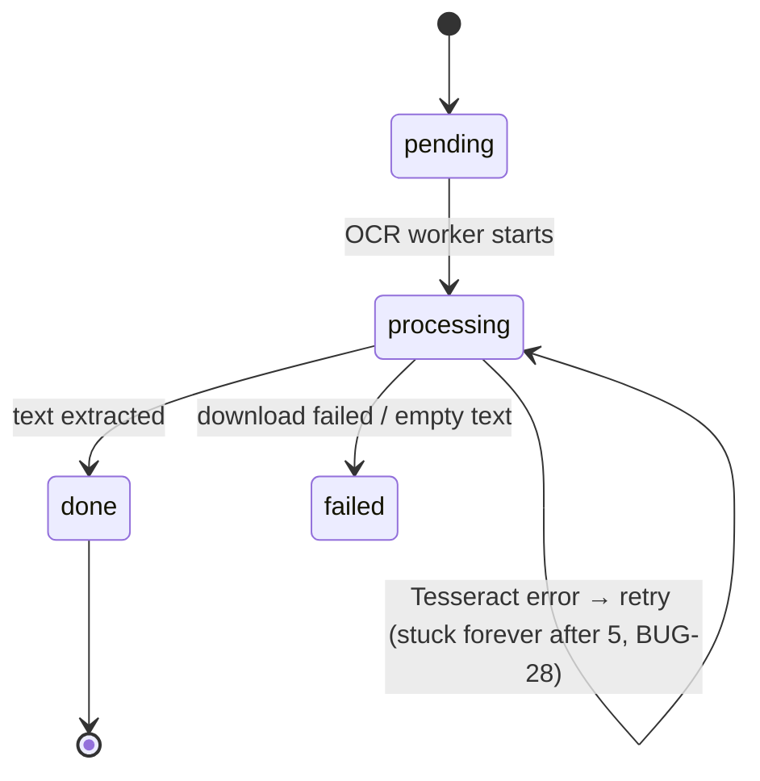
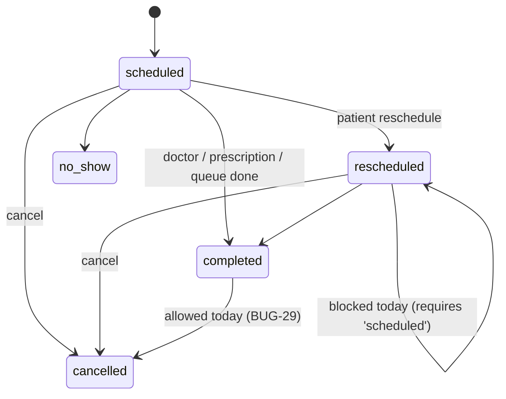

# Part IX — Computer Science and Design Principles (in this codebase)

Each concept: **simple definition → intuition → mechanism → where in BioPulse → trade-offs → interview Q&A.** Only concepts actually present are covered; future-only concepts are labelled 💡.

---

## 9.1 Asynchronous programming, promises and the event loop

- **Definition:** start work now, get the result later without blocking.
- **Intuition:** a waiter takes many orders and doesn't stand at the kitchen.
- **Mechanism:** `async` functions return Promises; `await` pauses the function (not the thread) and resumes in a microtask when the promise settles.
- **In BioPulse:**
  - Parallel I/O with `Promise.all`: `getTodaySchedule` (medicines + logs), `getReports` (find + count), worker loads (medicine + user).
  - Sequential awaits where parallel would be faster: `getPatientHistory` (4 queries), `findUsersWithFilter` (find then count).
  - `Promise.allSettled` for closing workers (no early rejection).
  - `Promise.race`-like timeout in `connectRedis` (setTimeout + resolve).
  - Fire-and-forget: `deleteCloudinaryObject(...).catch(...)` in `deleteReport` — response doesn't wait.
  - Retry loops with `await new Promise(r => setTimeout(r, delay))` (Groq, USDA).
- **Q:** *What's the latency difference in `getPatientHistory`?* — Sequential ≈ t1+t2+t3+t4; `Promise.all` ≈ max(t1..t4). With 4 × 20 ms → 80 ms vs ~20 ms.
- **Q:** *What happens to an un-awaited rejected promise?* — `unhandledRejection` → in this app logged, not fatal (`server.js:120`).

## 9.2 Closures and higher-order functions

- **Definition:** a closure is a function that remembers variables from where it was created; a higher-order function takes or returns functions.
- **In BioPulse:** `asyncHandler(fn)` returns a wrapper; `validate(schema)` returns middleware remembering `schema`; `requireRole(...roles)` remembers `roles`; `setTokenCookie` captures options; Zustand store actions close over `set/get`; `useReportPolling` closes over `startedAt` ref; the `delta(path)` helper in `getTrend` closes over `latest/previous`.
- **Q:** *Why is `validate(schema)` called at route-definition time, not per request?* — It returns a new middleware once; per request only the inner function runs.

## 9.3 Concurrency, race conditions and atomicity

- **Definition:** a race condition occurs when correctness depends on the timing of concurrent operations.
- **Mechanism in Node:** even single-threaded, `await` yields; two requests interleave between a *read* and the dependent *write*.
- **In BioPulse (check-then-act):** booking capacity + token (BUG-07), schedule duplicate check, report re-analyse, dose-log upsert without unique index, diet add (lost update), register (saved by the unique index), `deactivateAllPlans` then `create`.
- **Correct primitives in the code:** `$inc` with positional operator (atomic in one document); unique `email` index; deterministic BullMQ job ids.
- **Q:** *How do you prove a race exists?* — Write a test that fires N concurrent requests (`Promise.all`) and assert invariants (`booked ≤ max`, unique tokens). Then fix with conditional updates and rerun.

## 9.4 Idempotency

- **Definition:** doing an operation twice has the same effect as once.
- **In BioPulse:** `PUT /auth/fcm-token`, dose-log upsert (intended), `ocr-<id>` and `appt-<id>-1h` job ids, OCR worker re-entry (if `done` → just trigger AI), AI worker skip if `done`. Not idempotent: booking POST, AI job ids with timestamps, report upload.
- **Q:** *How would you make `POST /appointments` idempotent?* — Client sends an `Idempotency-Key` header; server stores key → response for 24 h (Redis `SET key value NX EX`), returns the stored response on retry.

## 9.5 State machines

**Report processing**

`analysis_status`: `pending → processing → done | failed`; `done → pending` via re-analyse (guard: OCR must be `done`, analysis not `processing`).

**Appointment**

**Queue status:** `waiting → in_consultation → completed`, `waiting → no_show` (no transition guards in the service).
- **Q:** *How would you enforce valid transitions?* — A transition table `{scheduled:['rescheduled','cancelled','completed','no_show'], …}` checked in one function, plus a conditional update `findOneAndUpdate({_id, status: {$in: allowedFrom}}, {status: to})`.

## 9.6 Data structures and complexity

| Code | Structure | Complexity | Comment |
|---|---|---|---|
| `getTodaySchedule` | `Map` keyed `"medId-ms"` | O(M·T + L) time, O(L) space | Hash join instead of nested loops O(M·T·L). |
| `getAdherenceStats` per-medicine | `logs.filter` per medicine | O(M·L) | Fine for small data; group once with a Map → O(M+L). |
| `getDoctorQueueStatus` | sorted array, `find`, `filter` | O(n) after DB sort | n = today's appointments. |
| Dashboard "My Patients" | `Set` of ids then `filter` per patient | O(P·A) | Could group once. |
| Slot generation | loop adding `slot_duration` | O((end−start)/duration) | ≤ 288 slots/day at 5 min. |
| `removeJobsForMedicine` | scan all repeatable jobs | O(total jobs in Redis) per call | Should be O(1) by id. |
| Notification store | array slice(0,50) | O(1) amortised | Bounded memory. |
| `countNonNull` | recursive DFS with depth guard | O(nodes) | Guard prevents runaway recursion. |
| Regex extraction | linear scans per pattern | O(P·|text|) | Text ≤ a few KB. |

## 9.7 Regular expressions (practical)

| Regex | Purpose | Pitfall |
|---|---|---|
| `^([01]\d|2[0-3]):([0-5]\d)$` | 24-h time | Rejects `8:00` (must be `08:00`). |
| `^[0-9a-fA-F]{24}$` | ObjectId format | |
| `^[\w.]+$` | Safe biomarker path | Allows `__proto__` segments (harmless here). |
| `HbA1c\s*[:\-]?\s*(\d+(?:\.\d+)?)\s*(%)?` | Capture value + optional unit | Non-capturing `(?:…)` for decimals. |
| `H(?:ae?mo)?globin` | Haemoglobin | Misses "Hemoglobin" (🔬). Correct: `Ha?emoglobin|Hb\b`. |
| `LDL(?:[- ]C(?:holesterol)?)?` | LDL | Also matches inside "VLDL"; use `\bLDL`. |
| `/(["'])(\\?.)*?\1/` in error handler | Extract quoted dup value | Back-reference `\1`; may return null → crash. |
| `/^```(?:json)?/i` | Strip code fences from LLM | |
| `/try again in ([\d.]+)s/` | Parse Groq back-off | Defensive parsing of provider text. |

## 9.8 Design patterns present

| Pattern | Where | Why |
|---|---|---|
| **Layered architecture** (routes → controllers → services → repositories → models) | backend | Separation of concerns; testable services. |
| **Repository** | `repositories/*` | Hide query details; inconsistently applied. |
| **Middleware / Chain of Responsibility** | Express pipeline | Each step handles or passes on. |
| **Factory functions** | `validate`, `requireRole`, `generateTokens`, `emailTemplates.*` | Configure behaviour once. |
| **Singleton (module-level instance)** | `redisConnection`, `io`, `transporter`, Firebase app, `QueryClient`, Zustand stores | One shared resource per process. |
| **Producer–Consumer** | services → BullMQ queues → workers | Decouple slow work. |
| **Publish–Subscribe / Observer** | Redis channel, Socket.IO rooms, worker event listeners, React Query subscriptions | Loose coupling of event sources and listeners. |
| **Retry with exponential backoff** | BullMQ options, Groq 429 parsing | Resilience to transient failures. |
| **Fallback / graceful degradation** | API starts without Redis; FCM mock mode; email never throws; AI fallback JSON | Availability over completeness. |
| **Facade** | `dispatchNotification` hides DB + Redis + FCM + email | One call for callers. |
| **Adapter** | `searchFoodsFromAPI` maps USDA → app shape | Isolate external schema. |
| **Single-flight** | axios refresh queue | One refresh for many 401s. |
| **Error boundary** | `ExpandedInsights` | Contain rendering failures. |
| **Optimistic update (attempted)** | `medicineStore` | UX responsiveness (broken wiring). |
| **Envelope / DTO** | `success()`/`error()` | Uniform contract. |
| 💡 **Outbox** | not present | Would fix DB+queue dual writes. |
| 💡 **Circuit breaker** | not present | Would stop hammering a failing Groq/USDA. |

## 9.9 SOLID — honest evaluation

| Principle | Good | Violations |
|---|---|---|
| S — single responsibility | Thin controllers; `jwt.js`, `email.js` focused | `workers/index.js` (565 lines: 6 workers + parsing); `aiSystem.js` mixes prompt, HTTP, scoring, trends; `Appointments.jsx` (1188 lines, 6 components). |
| O — open/closed | `PATIENT_DIET_RULES` table: add a type without code changes | Risk scoring hard-coded if/else chains. |
| L — Liskov | `AppError extends Error` behaves like an Error | — |
| I — interface segregation | Small API modules per area | `auth.api.js` also exports `notificationApi`. |
| D — dependency inversion | — | Services import concrete queues/models; the Redis connection opens at import time → hard to unit-test. Inject dependencies (pass queue/repo objects) to fix. |

## 9.10 Error propagation

```
service throws AppError(404,'NOT_FOUND')
  → async function rejects
  → asyncHandler .catch(next)   (Express 5 would do this anyway)
  → errorHandler(err) → sendError(res, code, message, status)
  → axios interceptor → normalized Error {message, code, status}
  → useMutation onError → toast.error(err.message)
```
Breaks in the chain: `dispatchNotification` swallows errors (workers think success); `generateHealthInsights` never throws (failures look like success); `updateMedicine` replaces the AppError with a driver error (BUG-06); validation messages lost (BUG-03).

## 9.11 Time, dates and time zones

- **Concept:** a `Date` is an instant (UTC ms). "08:00" or "2026-05-26" are *local* concepts that need a zone.
- **In BioPulse:** medicines use the client zone (`x-timezone` + dayjs) ✅; doctor schedules, appointment day boundaries, reminder cron patterns and email date strings use the **server** zone ❌; diet cron is fixed to Asia/Kolkata; the frontend parses `YYYY-MM-DD` as UTC.
- **Rule to state in interviews:** "Store instants in UTC; store the user's IANA zone; convert at the edges; never let the server's zone leak into business logic."

## 9.12 Caching

- **Present:** React Query client cache (30 s staleTime) and request de-duplication; HTTP `no-store` on status endpoints; BullMQ job dedupe.
- **Absent 💡:** server cache. Candidates: doctors list (Redis, 5 min TTL, invalidate on profile update), diet recommendations (static → in-memory), USDA search results (Redis 24 h keyed by query), unread notification count.

## 9.13 Networking concepts used

HTTP methods/status codes; CORS preflight (`OPTIONS`, `credentials`, custom header `x-timezone` triggers preflight); cookies (`HttpOnly`, `Secure`, `SameSite`); bearer tokens; multipart uploads; WebSockets via Socket.IO (upgrade from HTTP); gzip compression; HTTP keep-alive (affects graceful shutdown).

## 9.14 Numeric details

Calories from macros (4/4/9 kcal per g); rounding at each step (macro derivation gives 354 instead of 350); BMR formula; unit conversions (glucose ×18.018, cholesterol ×38.67, creatinine ÷88.4); percent change division by zero → `Infinity`; adherence rounding with `Math.round`; `parseInt` of query strings → `NaN` handling with `|| default`.

## 9.15 Memory considerations

OCR loads the entire file into a Buffer (`arraybuffer`, no size cap) → large PDFs/images consume memory per concurrent job (concurrency 2); Tesseract model (~5 MB) loaded per recognize call; `lean()` reduces memory for read-only queries; React Query keeps unused cache entries 5 min (default `gcTime`).
