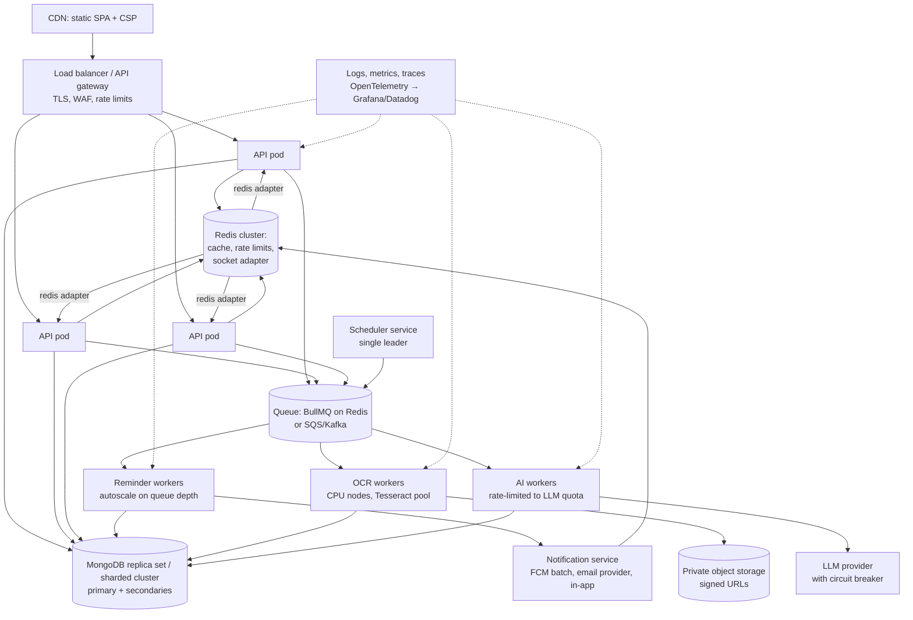

# Part X — System Design and Scalability

Rule for this chapter: **"Current"** = proven by the repository. **"Proposed" 💡** = my design; nothing in the repo shows it exists.

---

## 10.1 Current high-level design

| Component | Responsibility | Runs as |
|---|---|---|
| React SPA | UI, client caching, token refresh, polling | Static files (host not defined in repo) |
| API process (`server.js`) | REST, auth, validation, business rules, uploads, Socket.IO, cron enqueueing | One Node process (no clustering config) |
| Worker process (`npm run worker`) | Reminders, OCR, AI analysis, diet reminders | Separate Node process (must be started manually) |
| MongoDB | System of record | External (Atlas implied by transactions; ❓) |
| Redis | BullMQ queues, delayed jobs, pub/sub | External |
| Cloudinary | Report file storage | SaaS |
| Groq | LLM inference | SaaS |
| USDA | Food data | Public API |
| FCM / SMTP | Push / email | SaaS |

**Request path latency budget (typical, estimated):** network RTT + middleware (<1 ms) + JWT verify (~0.1 ms) + 1–4 MongoDB queries (1–10 ms each with indexes, more without) → most reads ≈ 10–50 ms server time. Chat endpoints add a Groq call (1–5 s); upload adds a Cloudinary upload (file-size dependent).

## 10.2 Low-level design highlights

- **Stateless API:** no server sessions (JWT); refresh state in MongoDB → API instances can scale horizontally *except* for: in-memory rate-limit counters, node-cron in every instance, Socket.IO rooms per instance.
- **Async boundary:** report processing and reminders go through Redis queues with retries.
- **Notification fan-out:** one function writes DB then pushes to Redis/FCM/email.
- **Read models:** "today schedule" and "queue status" are computed on read (no precomputed views).

## 10.3 Current bottlenecks and single points of failure

| Issue | Effect | Evidence |
|---|---|---|
| Workers don't start with API | No reminders/OCR unless a second process is run | BUG-01 🔬 |
| PDF crash | Worker process dies → all queues stop processing until restart | BUG-02 🔬 |
| Single MongoDB connection string | DB outage = full outage | `db.js` |
| Single Redis | Queues, delayed reminders, pub/sub lost/paused | `redis.js` |
| No indexes on hot paths | Collection scans grow with data | Part VI |
| Polling: notifications 30 s ×2 components (deduped), queue 30 s, schedule 60 s, report status 4 s | Read load proportional to open tabs | Frontend |
| Tesseract per-call workers, concurrency 2 | OCR throughput ≈ 2 reports at a time per worker process | `workers/index.js` |
| Groq rate limits | 429s under load; 45 s × 3 waits hold worker slots | `aiSystem.js` |
| Cron in every API instance | Duplicate reminders when scaled | `cron.js` |
| Rate-limit memory store | Limits not shared across instances | `app.js` |

---

## 10.4 Back-of-the-envelope capacity (assumptions clearly stated)

Assume **100,000 registered users, 10% daily active (10k DAU), peak 2,000 concurrent sessions**, each with one open tab.
- Notification polling: 2,000 / 30 s ≈ **67 req/s** just for the bell (+ queue polling for active appointments).
- Medicine reminders: avg 2 medicines × 2 times = 4 jobs/user/day → 400k jobs/day ≈ 4.6/s average, but **spiky at 08:00 and 20:00** (if everybody picks round times): could be tens of thousands within one minute.
- Each reminder = 1 DB insert + 1 user read + 1 publish + 1 FCM + 1 email → email is the bottleneck/cost driver.
- Reports: assume 1% of users upload per day = 1,000 OCR jobs/day; at ~10–20 s per OCR + 5–15 s LLM, 2 concurrent per process → ~4–8 jobs/min per process → 1,000/day needs ~1 worker process if evenly spread; peaks need autoscaling.
- Storage: report raw text + insights ~20–50 kB/report → 1,000/day ≈ 50 MB/day in MongoDB (files in Cloudinary).

These numbers are illustrative — say so in interviews.

---

## 10.5 Proposed architecture for 100k → 1M users 💡

### Key changes and why

| Change | Why |
|---|---|
| Fix BUG-01/02; deploy API and worker types separately with health checks | Correctness + independent scaling. |
| Socket.IO **Redis adapter** + authenticated sockets; push events instead of 30 s polling | Cuts read load; real-time. |
| Indexes from Part VI; keyset pagination; projections | Keep queries O(log n). |
| Read replicas for heavy reads (history, reports list) with `readPreference: secondaryPreferred` where staleness is OK | Offload primary. |
| Sharding key `user_id` for per-user collections (logs, notifications, reports) at very large scale | Even distribution; queries always include `user_id`. |
| Single scheduler (BullMQ job schedulers created once / leader election) | No duplicate cron. |
| Per-user time zone in reminders; jitter reminders ±1–2 min | Correct times, smooth 08:00 spike. |
| Notification service with batching (FCM `sendEach`/multicast, email via provider API with queues) | Throughput and cost. |
| OCR worker pool with long-lived Tesseract workers; PDF text-layer first; cache by file hash | 3–10× OCR throughput. |
| LLM: queue with concurrency matching quota, circuit breaker, fallback, cost metering per user | Survive provider limits. |
| Redis-backed rate limiting per user + per IP; idempotency keys | Abuse protection, safe retries. |
| Outbox pattern for DB + queue writes | No lost/orphan jobs. |
| Observability: request ids, structured logs without PHI, RED metrics, queue depth/age alerts | Detect and recover. |

---

## 10.6 Hard questions — answers to practise

### Q1. How would you scale BioPulse to 100,000 or 1 million users?
**Concise:** "The API is stateless with JWTs, so I'd run several instances behind a load balancer after moving the remaining in-process state — rate limits, cron and socket rooms — into Redis. I'd add the missing indexes, replace polling with authenticated sockets through the Redis adapter, scale workers separately on queue depth, and batch notifications. At a million users I'd shard per-user collections by `user_id` and use read replicas."
**Follow-up:** *What breaks first?* — "The 30-second notification polling and unindexed queries on MongoDB, then reminder spikes at round times and the LLM quota."

### Q2. What happens if MongoDB becomes unavailable?
**Current:** at startup the process exits (`connectDB` → `exit(1)`); at runtime Mongoose buffers commands for 10 s then requests fail with 500; the health endpoint still says "ok"; workers fail jobs and BullMQ retries those with attempts (OCR/AI/appointments) — medicine/diet reminders (1 attempt) are lost for that occurrence.
**Proposed:** replica set with automatic failover (driver retries writes once — `retryWrites` is on by default); readiness probe that fails when Mongo is down so the load balancer stops routing; shorter `bufferTimeoutMS` and clear 503 responses; jobs with attempts/backoff everywhere.

### Q3. What if Redis goes down?
**Current:** API keeps serving (offline queue buffers commands; after 10 reconnect attempts the client gives up → later `queue.add` calls fail → e.g. upload returns 500 after the report document was already created, leaving it `pending` forever). Delayed reminders stored only in Redis may be lost if Redis lost data.
**Proposed:** Redis with persistence (AOF) and replication (managed Redis), outbox to recreate jobs, reconciliation job to rebuild schedulers from MongoDB, and an unbounded retry strategy with alerts.

### Q4. How do you handle concurrent requests safely?
"Push the invariant into the database: conditional atomic updates (`$inc` only when `booked < max`), unique indexes (one schedule per doctor per day, one log per dose, token numbers), and compare-and-set status changes. Use transactions only where several documents must change together."

### Q5. How do you prevent duplicate operations?
"Idempotency keys for POSTs, deterministic job IDs (already used for OCR and appointment reminders), unique indexes, and disabling buttons while mutations are pending (already done in the UI)."

### Q6. How would you reduce latency?
"Indexes; `Promise.all` for independent queries (patient history); projections and `lean()`; caching static or slow data (doctor list, recommendations, USDA results); compress responses (already); move LLM chat to streaming responses so users see tokens immediately; CDN for the SPA; code-split heavy pages (Recharts)."

### Q7. How do you handle slow external services (Groq, USDA, Cloudinary)?
"Timeouts on every call (mostly present), retries with backoff and jitter only for retryable errors (present for Groq/USDA), a circuit breaker to fail fast when a provider is down, async processing via queues for anything non-interactive (reports already), graceful fallbacks (AI fallback JSON exists, but should be marked as `failed`/`degraded`, not `done`)."

### Q8. How would you avoid single points of failure?
"Multiple API instances across zones; managed MongoDB replica set; managed Redis with replica; at least two worker instances per queue type; health checks and auto-restart; no in-memory state that matters; backups with tested restores."

### Q9. What should be cached?
| Data | Where | TTL / invalidation |
|---|---|---|
| Doctors list by specialisation | Redis | 5 min, invalidate on doctor profile update |
| Diet recommendations (static rules) | Process memory | Forever (deploy-time) |
| USDA search results | Redis | 24 h by normalised query |
| Unread notification count | Redis counter | Increment on create, decrement on read |
| Today's schedule | Client (React Query) | Invalidate on dose log (exists) |
**Never cache** without care: per-user medical data in shared caches (key by user, short TTL, encrypt if needed).

### Q10. What should be processed in the background?
Already: OCR, AI analysis, reminders. Should also be: emails (separate queue with provider rate limits), push batches, Cloudinary deletion/cleanup, account deletion cascade, adherence aggregates (nightly), slot-count reconciliation, report re-analysis bulk jobs.

### Q11. How would you monitor and recover from failures?
"Structured JSON logs with request ids (partially present in workers), metrics (request rate/errors/latency per route, queue depth and oldest job age, job failure rate, LLM latency/cost), traces across API → queue → worker, alerts on error-rate and queue-age SLOs, dead-letter handling for failed jobs with a re-drive tool, and runbooks. For recovery: retries, idempotent workers, reconciliation jobs, and backups."

### Q12. Would you split this into microservices?
"Not yet. A modular monolith with separate worker deployments gives most benefits. I'd extract a notification service first because it has distinct scaling and provider concerns, then OCR/AI processing. Splitting earlier adds network failure modes and operational cost."

### Q13. Why MongoDB instead of PostgreSQL — would you switch?
"MongoDB fits nested AI and meal data. But appointments, slots and prescriptions are relational with strong integrity needs. At scale I might keep Mongo for documents (reports, AI insights) and use Postgres for scheduling and billing — or stay on Mongo and enforce integrity with unique indexes and transactions. I'd decide from query patterns, not fashion."

---

## 10.7 Trade-off table (for "why did you choose X")

| Decision | Benefit | Cost | Alternative |
|---|---|---|---|
| JWT + refresh cookie | Stateless scale, standard | Revocation delay ≤15 min | Server sessions in Redis |
| BullMQ on Redis | Simple, Node-native, delays/retries | Redis is critical infra | SQS + EventBridge, RabbitMQ, Kafka |
| Polling for queue/notifications | Simple, robust | Load, ≤30 s staleness | Sockets/SSE |
| Tesseract in-house OCR | Free, private | Slow, CPU-heavy, accuracy | Cloud OCR (Textract/Document AI) |
| Groq LLM | Fast, cheap | PHI to third party, rate limits | Self-hosted model, Azure OpenAI with BAA |
| Cloudinary | Easy uploads/transforms | Public URLs by default, vendor lock-in | S3 with signed URLs (AWS SDK already in package.json) |
| Mongo embedded slots | Atomic per-slot `$inc` | Document growth; whole-schedule reads | Separate slots collection |
| Rule-based risk score | Deterministic, explainable | Poor calibration | Validated clinical scores |
